<div align="center">

# SunuSafeguard AI

**Plateforme intelligente de soutien psychosocial, d'orientation et de protection**

Écoute bienveillante en français et en wolof · Orientation vers des structures d'aide · Pilotage anonyme de l'impact

Conçue par **GREEN T SARL** — Sénégal

**Français** · [English](README.md)


</div>

---

## Sommaire

1. [Le projet en bref](#-le-projet-en-bref)
2. [Fonctionnalités](#-fonctionnalités)
3. [Architecture générale](#-architecture-générale)
4. [Le moteur d'intelligence artificielle](#-le-moteur-dintelligence-artificielle)
5. [Parcours d'une conversation](#-parcours-dune-conversation)
6. [Mise en relation avec une structure](#-mise-en-relation-avec-une-structure)
7. [Base de connaissances et validation des documents](#-base-de-connaissances-et-validation-des-documents)
8. [Rôles, accès et authentification](#-rôles-accès-et-authentification)
9. [Modèle de données](#-modèle-de-données)
10. [Sécurité et confidentialité](#-sécurité-et-confidentialité)
11. [Application mobile « Sunu »](#-application-mobile--sunu-)
12. [Stack technique](#-stack-technique)
13. [Arborescence du dépôt](#-arborescence-du-dépôt)
14. [Installation et démarrage](#-installation-et-démarrage)
15. [Configuration](#-configuration)
16. [Comptes de test](#-comptes-de-test)
17. [API](#-api)
18. [Tests et qualité](#-tests-et-qualité)
19. [Déploiement](#-déploiement)
20. [Feuille de route](#-feuille-de-route)
21. [Bonnes pratiques d'exploitation](#-bonnes-pratiques-dexploitation)
22. [Documentation complémentaire](#-documentation-complémentaire)

---

## 🌍 Le projet en bref

Beaucoup de femmes et de jeunes filles au Sénégal font face à des violences, à de la détresse
psychologique ou à des situations d'urgence sans savoir **à qui parler** ni **vers qui se tourner**.
SunuSafeguard AI leur offre :

| Pour… | SunuSafeguard apporte… |
|---|---|
| **La personne qui cherche de l'aide** | Un assistant conversationnel disponible à toute heure, en français et en wolof, qui écoute sans juger, donne des informations fiables et sourcées, détecte les situations d'urgence et propose une orientation vers une structure adaptée, **sans conserver la conversation**. |
| **Les structures partenaires** (centres d'écoute, associations, services sociaux) | Un espace pour tenir à jour leur fiche et leurs disponibilités, recevoir les demandes de mise en relation consenties et suivre leur traitement. |
| **Les institutions et bailleurs** | Des indicateurs d'impact **strictement anonymes** (seuil de publication N ≥ 5), des cartes par région et des rapports PDF / Excel. |
| **Les expert·es** (juristes, psychologues, linguistes) | Un circuit de validation des documents qui alimentent l'assistant : rien n'est utilisé tant que ce n'est pas publié. |
| **L'équipe technique GREEN T** | La supervision de la qualité de l'IA, des performances, des garde-fous, des comptes et du journal d'audit. |

### Principes directeurs

- **La sécurité de la personne passe avant tout** : les règles d'urgence sont déterministes et priment sur l'IA.
- **Aucune conversation n'est stockée** : ni en base, ni dans les journaux.
- **Jamais de diagnostic, jamais de fausse promesse** : un contrôle de sortie remplace toute réponse problématique.
- **Toujours sourcé** : l'assistant ne répond qu'à partir de documents validés et cite ses sources.
- **Consentement explicite** avant toute transmission à une structure.
- **IA souveraine et gratuite** : le modèle de langage et la reconnaissance vocale tournent en local, sans service payant.

---

## ✨ Fonctionnalités

| Espace | Contenu | État |
|---|---|---|
| **Interface publique (site web, PWA)** | Accueil, assistant conversationnel FR / WO, annuaire des structures, mise en relation avec consentement, suivi par code, page confidentialité, **bouton Sortie rapide** (et touche Échap × 2), mode sombre par défaut, conçue d'abord pour le téléphone | ✅ |
| **Application mobile « Sunu »** | Android / iOS (Expo) : écoute vocale, réponse, ressources, session, **mode discret** déguisé en calculatrice | ✅ |
| **Backend FastAPI** | Authentification JWT, contrôle d'accès par rôle côté serveur, verrouillage après échecs, inscription publique, déconnexion avec révocation du jeton, documentation OpenAPI sur `/api/docs` | ✅ |
| **Moteur IA** (`ai-engine/`) | Détection de langue, classification des besoins, garde-fous déterministes (urgence, injection de prompt, hors périmètre, demande de diagnostic), recherche hybride (RAG) avec sources citées, LLM local via Ollama et **repli extractif**, contrôle de sortie | ✅ |
| **Sunu Impact** | Indicateurs clés, évolution, besoins, langues, canaux, carte des régions, rapports PDF / Excel, seuil N ≥ 5 | ✅ |
| **Sunu Orientation** | Fiches des structures, disponibilités et historique, validation, demandes de mise en relation, délais, alertes de non-réception, gestion d'équipe | ✅ |
| **Sunu Ressources** | Import PDF / DOCX / TXT, découpage, indexation, circuit de validation, banc d'essai RAG, lacunes, évaluation | ✅ |
| **Sunu Tech** | Qualité de l'IA, latences, garde-fous, état des services, CPU / RAM, journal d'audit, purge, métriques Prometheus `/metrics` | ✅ |
| **Comptes et accès** | Comptes créés avec mot de passe provisoire, rôles, désactivation, réinitialisation ; un responsable partenaire gère l'équipe de sa structure | ✅ |
| **Sécurité des accès** | Double authentification TOTP (QR code) obligatoire pour les comptes privilégiés, changement de mot de passe, limitation de débit sur la connexion et le chat | ✅ |
| **Conservation des données** | Purge automatique toutes les 24 h selon la politique configurée, purge manuelle depuis Sunu Tech | ✅ |
| **Reconnaissance vocale** | Whisper-small local (français et wolof), sur processeur, audio jamais écrit sur disque | ✅ |
| **Synthèse vocale wolof** | Aucune solution gratuite et fiable identifiée à ce jour | 🔜 Prochaine version |

---

## 🏗 Architecture générale

### Vue d'ensemble

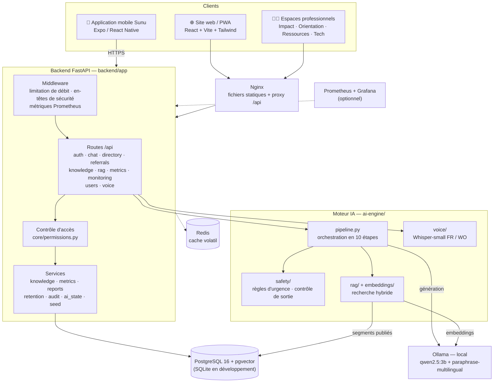

### Organisation en couches du backend

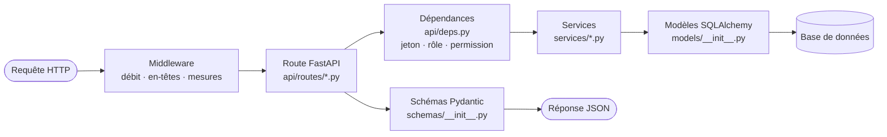

Chaque route qui touche à des données professionnelles déclare la permission requise avec
`require("permission")`. **C'est l'API qui fait foi** : l'interface masque les espaces non
autorisés, mais le serveur refuse toujours l'accès, même si l'appel est forgé à la main.

### Démarrage du backend

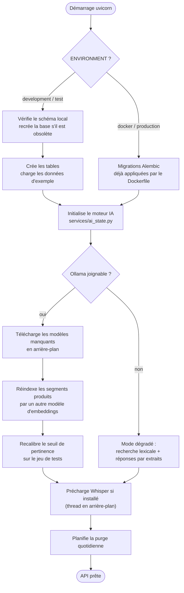

---

## 🧠 Le moteur d'intelligence artificielle

Le moteur IA (`ai-engine/`) est un module Python indépendant, appelé par le backend. Il
n'enregistre **aucune donnée de conversation**.

### La chaîne de traitement en 10 étapes

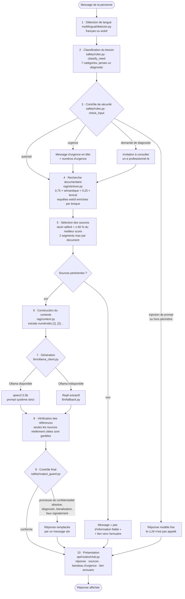

### Détail des étapes

| Étape | Module | Ce qu'elle fait |
|---|---|---|
| 1. Langue | `multilingual/detector.py` | Heuristique français / wolof avec indice de confiance. À remplacer par un modèle évalué. |
| 2. Besoin | `safety/rules.py::classify_need` | Mots-clés → 7 catégories : écoute psychosociale, violences physiques et verbales, violences économiques, cyberharcèlement, hébergement et protection, information juridique, santé reproductive. |
| 3. Sécurité | `safety/rules.py::check_input` | Règles **déterministes** : `urgent`, `refuse_injection`, `out_of_scope`, `redirect_professional`, `allow`. L'urgence prime toujours. Distingue une urgence vécue par la personne et une urgence concernant un tiers. |
| 4. Recherche | `rag/retriever.py` | Recherche **hybride** : 75 % similarité cosinus sémantique (Ollama `paraphrase-multilingual`) et 25 % lexicale. Recherche lexicale seule si Ollama est absent. Les requêtes en wolof sont enrichies grâce au lexique `multilingual/lexicon.py`. |
| 5. Sélection | `pipeline.py` | Seuil absolu **calibré au démarrage** (`evaluation/calibrate.py`) et seuil relatif (≥ 60 % du meilleur score). Seuil relevé en situation d'urgence. |
| 6. Contexte | `rag/context.py` | Extraits numérotés transmis au modèle. |
| 7. Génération | `llm/ollama_client.py` | `qwen2.5:3b` par défaut, prompt système strict (`llm/prompts.py`). Le texte de la personne est délimité pour éviter l'injection. |
| 8. Références | `pipeline.py` | Seules les sources effectivement citées sont renvoyées. |
| 9. Contrôle final | `safety/output_guard.py` | Remplace toute réponse qui promettrait une confidentialité absolue, poserait un diagnostic, banaliserait une violence ou annoncerait un faux signalement. |
| 10. Présentation | `backend/app/api/routes/chat.py` | Réponse, sources, bandeau d'urgence, suggestion d'annuaire. |

### Fonctionnement sans connexion au modèle

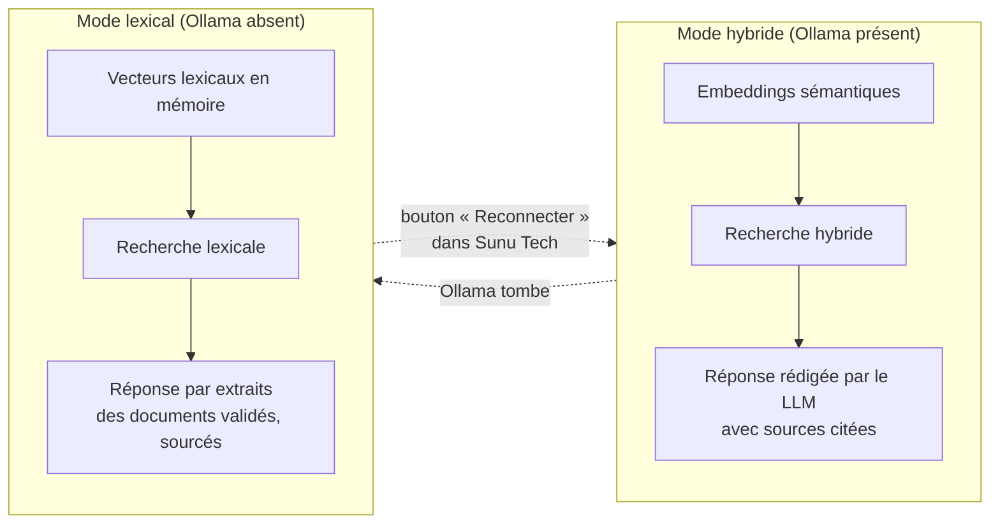

L'assistant **reste toujours en service**. L'état du moteur (mode, modèle, seuil, téléchargements)
est visible dans **Sunu Tech → Performance RAG & IA** et exposé par `GET /api/monitoring/ai-engine`.

### Le wolof

Les petits modèles open source ne maîtrisent pas encore le wolof. Plutôt que d'inventer du wolof
approximatif, l'assistant répond en **français simple**, précédé d'une phrase wolof issue d'un
modèle validable (`llm/fallback.py`). La reconnaissance vocale wolof utilise un Whisper-small affiné
sur 57 h de wolof (`M9and2M/whisper-small-wolof`, licence MIT).

---

## 💬 Parcours d'une conversation

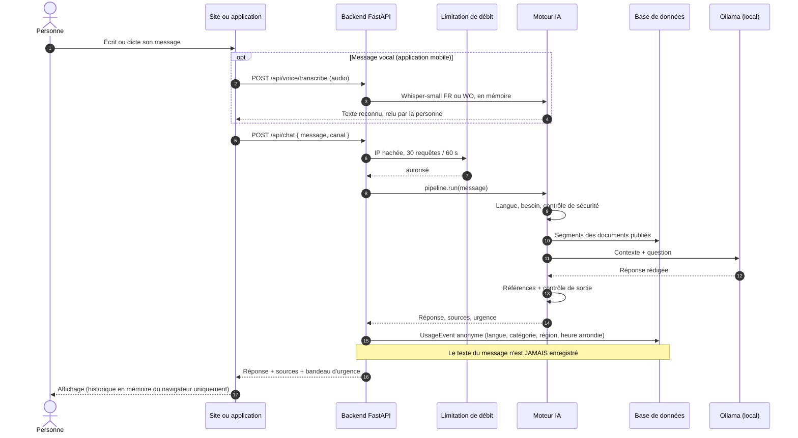

---

## 🤝 Mise en relation avec une structure

Une mise en relation n'est créée **qu'avec le consentement explicite** de la personne. Ses
coordonnées sont **chiffrées** (Fernet) et **effacées** dès la clôture de la demande.

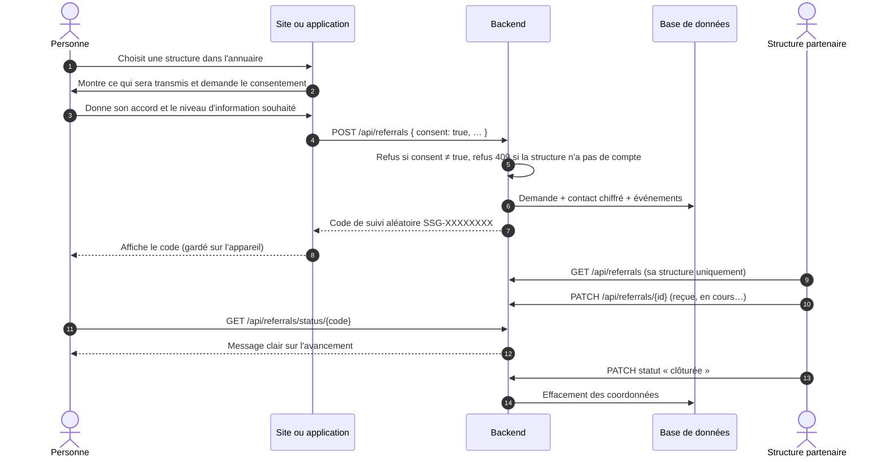

### Cycle de vie d'une demande

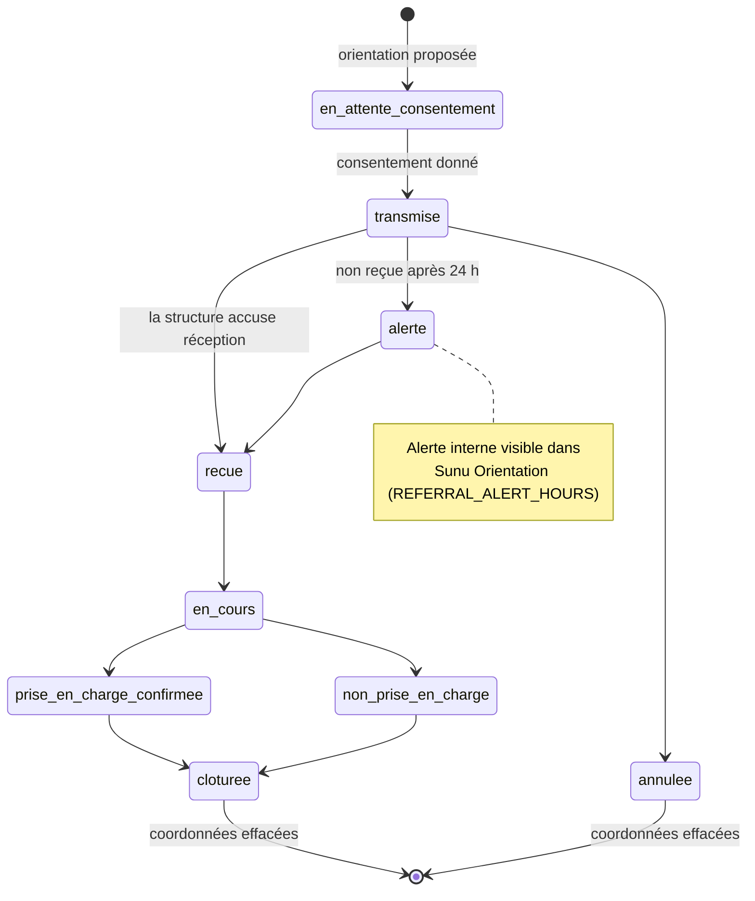

---

## 📚 Base de connaissances et validation des documents

Seuls les documents au statut **publié** alimentent l'assistant. Chaque document passe par un
circuit de validation tracé (versions, relectures, audit).

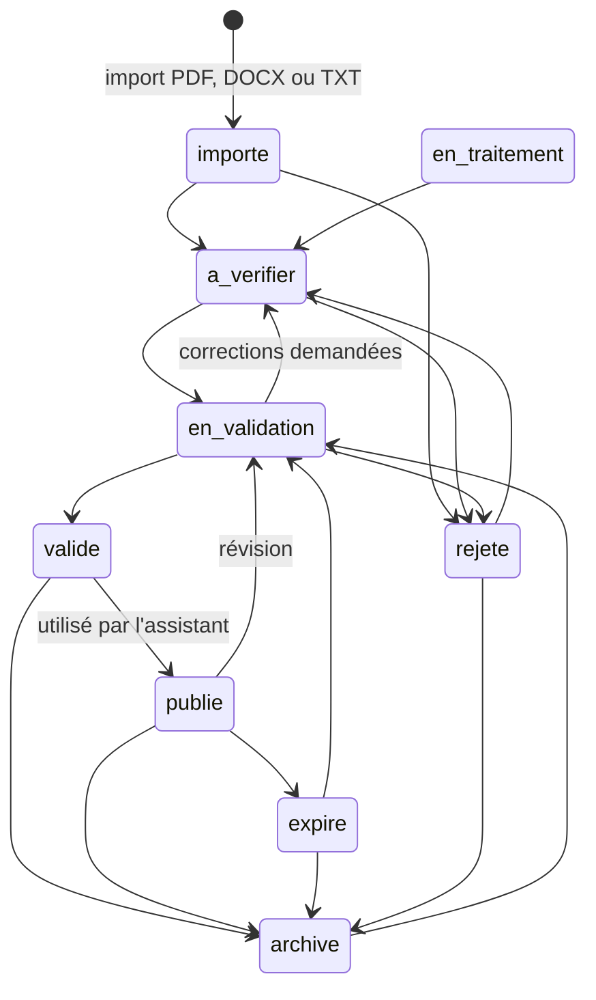

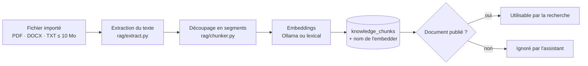

Contenus fournis (`data/knowledge_base/`) : écoute psychosociale, violences conjugales et droits,
cyberharcèlement, violences économiques, hébergement et orientation, santé reproductive, bien-être,
stress, soutien d'un proche, idées suicidaires, ressources au Sénégal, confidentialité.

---

## 🔐 Rôles, accès et authentification

### Profils principaux

La plateforme s'articule autour de trois profils principaux :

| Profil | Rôle technique | Peut faire | Ne peut pas faire |
|---|---|---|---|
| **Utilisateur** | `utilisateur` | Utiliser l'assistant et l'annuaire, créer un compte par inscription publique, suivre ses propres demandes (`GET /api/referrals/mine`) | Accéder à un espace d'administration (« Accès refusé ») |
| **Administrateur opérationnel** | `admin_operationnel` | Ressources, annuaire, orientations, indicateurs d'impact, rapports, sur toutes les structures | Gérer les comptes, voir la supervision technique |
| **Super administrateur GREEN T** | `super_admin` | Tout : comptes et rôles, configuration technique, supervision, journaux | — |

Des rôles plus fins sont également disponibles : administrateur technique,
responsable institutionnel, analyste, responsable partenaire, travailleur social, expert
documentaire, expert linguistique.

### Matrice des espaces

| Espace | super_admin | admin_operationnel | admin_technique | institutionnel / analyste | partenaire / travailleur social | experts | utilisateur |
|---|:---:|:---:|:---:|:---:|:---:|:---:|:---:|
| Sunu Impact | ✅ | ✅ | | ✅ | | | |
| Sunu Orientation | ✅ | ✅ | | | ✅ *(sa structure)* | | |
| Sunu Ressources | ✅ | ✅ | | | | ✅ | |
| Sunu Tech | ✅ | | ✅ | | | | |
| Gestion des comptes | ✅ | | | | ✅ *(responsable, sa structure)* | | |

La matrice complète des permissions est versionnée dans
[`backend/app/core/permissions.py`](backend/app/core/permissions.py), ce qui la rend auditable.

### Connexion avec double authentification

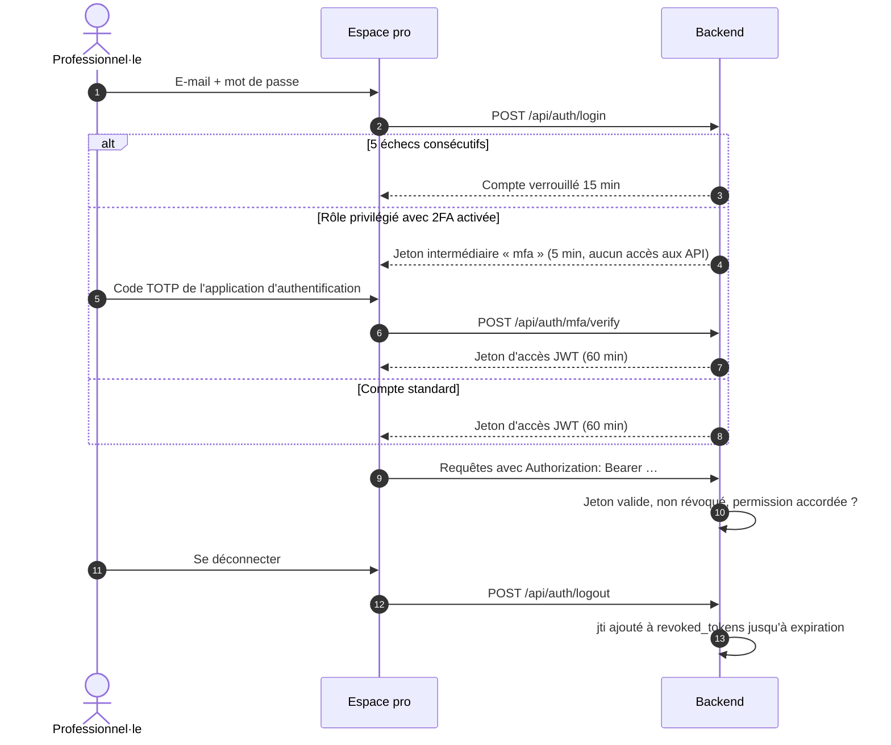

---

## 🗄 Modèle de données

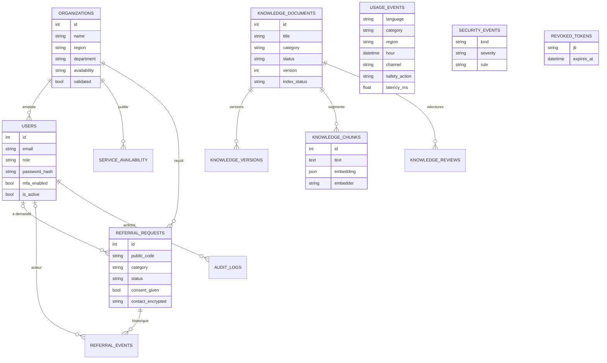

Autres tables : `rag_evaluations`, `ai_model_configurations`, `safety_rules`, `aggregate_metrics`,
`reports`. Le schéma complet est dans [`backend/app/models/__init__.py`](backend/app/models/__init__.py)
et les migrations Alembic dans [`backend/migrations/versions/`](backend/migrations/versions/).

> [!NOTE]
> `USAGE_EVENTS` est la seule source des indicateurs : langue, catégorie, région **déclarée**,
> canal et heure **arrondie**. Aucun identifiant de session, aucun texte.

---

## 🛡 Sécurité et confidentialité

### Ce que le code garantit aujourd'hui

| Exigence | Mise en œuvre | Vérifiée par |
|---|---|---|
| Conversations non conservées | Aucune table ne stocke le texte ; historique en `sessionStorage` (site) ou en mémoire (mobile) | `test_chat_never_stores_message_text` |
| Journaux sans contenu sensible | `SecurityEvent` ne garde que la règle déclenchée ; Nginx `access_log off` | idem |
| Statistiques anonymes | `UsageEvent` sans identifiant de session | — |
| Seuil de publication N ≥ 5 | `services/metrics.py::suppress`, aussi dans l'export Excel | `test_k_anonymity_suppression` |
| Consentement avant transmission | `POST /api/referrals` refuse sans `consent=true` | `test_referral_requires_consent` |
| Code de suivi non corrélable | Code aléatoire `SSG-XXXXXXXX` | — |
| Données d'orientation chiffrées | Fernet (`DATA_ENCRYPTION_KEY`), effacées à la clôture | — |
| Isolation des partenaires | Filtrage serveur par `organization_id` | `test_partner_isolation` |
| Contrôle d'accès côté serveur | `require(permission)` sur chaque route | `test_dashboard_permissions` |
| Inscription publique sans privilège | Rôle `utilisateur` imposé par le serveur | `test_roles.py` |
| Déconnexion effective | Jeton révoqué (`revoked_tokens`) | `test_roles.py` |
| Protection contre la force brute | Verrouillage 15 min après 5 échecs + limitation de débit par IP hachée | `test_rate_limit_on_chat` |
| Double authentification | TOTP (RFC 6238) obligatoire pour `super_admin` et `admin_technique` | `test_mfa_enrolment_and_login` |
| Conservation et purge | Purge quotidienne + manuelle | `test_retention_purge` |
| Pas de signalement automatique | Aucune intégration sortante ; contrôle de sortie | `test_output_guard` |
| Injection de prompt | Règles déterministes + consignes système + texte délimité | `test_prompt_injection_refused` |
| Documents non validés exclus | Seul le statut `publie` est chargé | `test_unpublished_document_not_used` |
| En-têtes HTTP | `nosniff`, `X-Frame-Options: DENY`, `no-referrer`, `Cache-Control: no-store` | — |
| Sortie rapide | Bouton sur chaque écran, Échap × 2, efface la session, `location.replace` | — |

### Durées de conservation par défaut

| Données | Durée | Variable |
|---|---|---|
| Événements d'usage anonymes | 395 jours | `RETENTION_USAGE_DAYS` |
| Événements de sécurité | 180 jours | `RETENTION_SECURITY_DAYS` |
| Journal d'audit | 730 jours | `RETENTION_AUDIT_DAYS` |
| Demandes de mise en relation | 365 jours | `RETENTION_REFERRAL_DAYS` |

### Ce qui circule et ce qui ne circule jamais

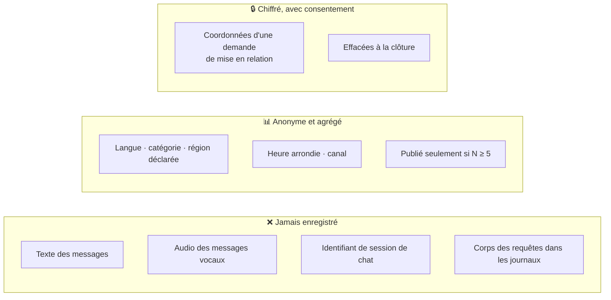

---

## 📱 Application mobile « Sunu »

Application Android / iOS dans [`frontend/mobile/`](frontend/mobile/), branchée sur la même API,
avec le même design que le site (palette Teranga, thème sombre par défaut).

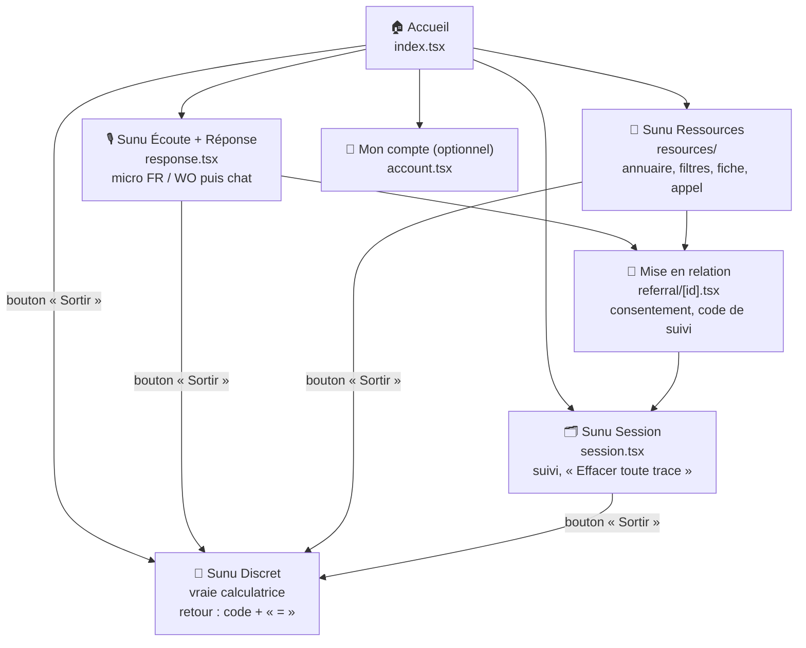

| Protection côté téléphone | Détail |
|---|---|
| Conversation | En mémoire seulement, effacée à la fermeture, à « Sortir » ou à l'effacement |
| Codes de suivi et réglages | Stockage chiffré du système (`expo-secure-store`) ; demande close effacée après 30 jours, toute demande après 180 jours |
| Annuaire hors connexion | Copie locale de l'annuaire public (aucune donnée personnelle) |
| Discrétion | Android : écran masqué dans les applications récentes et captures bloquées ; iOS : flou dans le sélecteur |
| Micro | Coupé en arrière-plan et à « Sortir » ; seule permission demandée |
| Notifications | Aucune |

Lancement, compilation Android et tests : voir [`frontend/mobile/README.md`](frontend/mobile/README.md)
et le [guide utilisatrice](docs/user-guides/guide-app-mobile.md).

---

## 🧰 Stack technique

| Couche | Technologies |
|---|---|
| **Site web** | React 18, TypeScript, Vite 5, Tailwind CSS 3, Recharts, PWA (service worker) |
| **Mobile** | Expo SDK 58, React Native, Expo Router, TypeScript, Zustand, expo-secure-store, expo-speech |
| **Backend** | Python 3.11+, FastAPI, SQLAlchemy 2, Alembic, Pydantic 2, PyJWT, cryptography (Fernet) |
| **Documents et rapports** | pypdf, python-docx, openpyxl, fpdf2 |
| **IA** | Ollama (`qwen2.5:3b`, `paraphrase-multilingual`), RAG hybride maison, garde-fous déterministes |
| **Voix** | Transformers + PyAV, Whisper-small (FR) et Whisper-small wolof, sur processeur |
| **Données** | PostgreSQL 16 + pgvector (production), SQLite (développement), Redis (cache volatil) |
| **Exploitation** | Docker Compose, Nginx, Prometheus, Grafana, psutil |
| **Tests** | pytest, Jest, vérification TypeScript |

---

## 📂 Arborescence du dépôt

```text
SUNUSAFEGUARD/
├── ai-engine/                 Moteur IA (Python, indépendant du web)
│   ├── pipeline.py            Orchestration de la chaîne en 10 étapes
│   ├── safety/                Règles d'urgence, classification, contrôle de sortie, PII
│   ├── rag/                   Extraction, découpage, contexte, recherche hybride
│   ├── embeddings/            Embeddings Ollama et lexicaux (hashing)
│   ├── llm/                   Client Ollama, prompts, repli extractif, messages modèles
│   ├── multilingual/          Détection de langue, lexique wolof
│   ├── evaluation/            Évaluation RAG, calibrage du seuil
│   └── voice/                 Reconnaissance vocale Whisper
├── backend/                   API FastAPI
│   ├── app/
│   │   ├── main.py            Application, middleware, démarrage, purge planifiée
│   │   ├── api/routes/        auth, chat, directory, referrals, knowledge, rag,
│   │   │                      metrics, monitoring, users, voice
│   │   ├── core/              config, permissions (RBAC), sécurité, TOTP, débit
│   │   ├── models/            Modèles SQLAlchemy
│   │   ├── schemas/           Schémas Pydantic
│   │   ├── services/          Connaissances, indicateurs, rapports, conservation, audit
│   │   └── cli.py             Commandes : seed, evaluate, ai-status, import-orgs…
│   ├── migrations/            Migrations Alembic
│   └── tests/                 Tests pytest
├── frontend/                  Site web React (public + espaces professionnels)
│   ├── src/pages/public/      Accueil, Chat, Annuaire, Connexion, Confidentialité
│   ├── src/pages/dashboards/  Impact, Orientation, Ressources, Tech, Compte
│   └── mobile/                Application mobile Expo « Sunu »
├── data/
│   ├── knowledge_base/        Documents sources de l'assistant (Markdown)
│   ├── seed/                  Comptes, structures, numéros d'urgence
│   ├── evaluation/            Jeu de tests RAG
│   └── fixtures/              Fichiers d'exemple pour l'import
├── infrastructure/            Dockerfile du site, Nginx, PostgreSQL, Prometheus, sauvegardes
├── docs/                      Architecture, API, sécurité, base de données, déploiement, guides
├── scripts/                   Démarrage local (Windows, Unix), test de fumée
├── docker-compose.yml
├── Makefile
└── .env.example
```

---

## 🚀 Installation et démarrage

### Prérequis

| Outil | Version | Obligatoire |
|---|---|---|
| Python | 3.11 ou plus | Oui |
| Node.js | 20 ou plus | Oui |
| Ollama | récent | Non : sans lui, l'assistant répond par extraits |
| Docker + Docker Compose | récent | Seulement pour la pile complète |

### Option 1 — Démarrage local sans Docker

**Windows (PowerShell)**

```powershell
git clone https://github.com/Dioumadev221/SUNUSAFEGUARD.git
cd SUNUSAFEGUARD
copy .env.example .env
.\scripts\dev.ps1
```

**Linux / macOS / WSL**

```bash
git clone https://github.com/Dioumadev221/SUNUSAFEGUARD.git
cd SUNUSAFEGUARD
cp .env.example .env
make install    # une seule fois
make backend    # terminal 1 → http://localhost:8000/api/docs
make frontend   # terminal 2 → http://localhost:5173
```

Au premier démarrage, une base SQLite est créée et remplie avec des données d'exemple :
documents indexés, structures, comptes et activité **synthétique** pour les graphiques.

### Option 2 — Pile complète avec Docker

```bash
cp .env.example .env          # puis changer JWT_SECRET, DATA_ENCRYPTION_KEY et les mots de passe
docker compose up -d --build  # http://localhost:8080
docker compose --profile monitoring up -d   # en plus : Prometheus :9090 et Grafana :3000
```

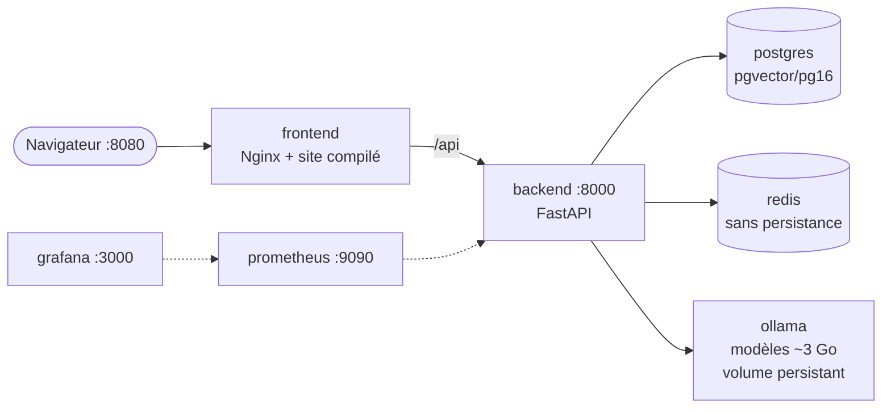

### Activer l'IA générative (Ollama)

| Rôle | Modèle par défaut | Taille | Variable |
|---|---|---|---|
| Rédaction des réponses | `qwen2.5:3b` | ~2 Go | `OLLAMA_MODEL` |
| Embeddings sémantiques (FR + wolof approximatif) | `paraphrase-multilingual` | ~0,6 Go | `EMBEDDING_MODEL` |

1. Installer Ollama (Windows : `winget install Ollama.Ollama`).
2. Lancer le backend : les modèles manquants sont **téléchargés automatiquement en arrière-plan**
   (`OLLAMA_AUTO_PULL=true`), les documents sont réindexés et le seuil recalibré.
3. Vérifier l'état : `python -m app.cli ai-status` (dans `backend/`).

### Activer la reconnaissance vocale (optionnel)

```bash
cd backend
pip install --index-url https://download.pytorch.org/whl/cpu torch
pip install -r requirements-voice.txt
```

Les modèles Whisper (~1 Go) sont téléchargés une seule fois depuis Hugging Face au premier usage.

### Lancer l'application mobile

```powershell
.\scripts\dev-mobile.ps1      # API joignable sur le Wi-Fi (port 8001) + Expo
```

Puis ouvrir Expo Go sur un téléphone connecté au même Wi-Fi. Détails dans
[`frontend/mobile/README.md`](frontend/mobile/README.md).

### Commandes utiles

| Commande | Effet |
|---|---|
| `make test` | Tests backend + IA, puis vérification TypeScript du site |
| `make eval` | Évaluation du RAG sur `data/evaluation/rag_testset.json` |
| `make seed` | Recharge les données d'exemple |
| `make llm-local` | Télécharge les modèles dans un Ollama local |
| `make docker-up` / `make docker-down` | Démarre / arrête la pile Docker |
| `python -m app.cli import-orgs <fichier> --hide-demo` | Importe des structures réelles et masque les structures d'exemple |

---

## ⚙️ Configuration

Toute la configuration passe par des variables d'environnement (fichier `.env`, modèle dans
[`.env.example`](.env.example)). **Ne jamais committer `.env`.**

| Groupe | Variable | Défaut | Rôle |
|---|---|---|---|
| Application | `ENVIRONMENT` | `development` | `development` crée les tables et les données d'exemple |
| | `CORS_ORIGINS` | `http://localhost:5173,http://localhost:8080` | Origines autorisées |
| Base | `DATABASE_URL` | SQLite local | URL PostgreSQL en production |
| Sécurité | `JWT_SECRET` | *à changer* | Secret de signature des jetons |
| | `JWT_EXPIRE_MINUTES` | `60` | Durée de validité d'un jeton |
| | `DATA_ENCRYPTION_KEY` | *vide* | Clé Fernet des données d'orientation |
| | `DEMO_PASSWORD` | `SunuDemo2026!` | Mot de passe des comptes de test |
| IA | `LLM_PROVIDER` | `ollama` | `ollama` ou `none` (réponses par extraits uniquement) |
| | `OLLAMA_URL` | `http://127.0.0.1:11434` | Adresse d'Ollama (IPv4 pour éviter ~2 s de latence sous Windows) |
| | `OLLAMA_MODEL` | `qwen2.5:3b` | Modèle de génération |
| | `OLLAMA_AUTO_PULL` | `true` | Téléchargement automatique des modèles |
| | `EMBEDDING_PROVIDER` | `auto` | `auto`, `ollama` ou `hashing` |
| | `EMBEDDING_MODEL` | `paraphrase-multilingual` | Modèle d'embeddings |
| | `RAG_MIN_SCORE` | *calibré* | Seuil fixe (laisser vide pour le calibrage automatique) |
| | `RAG_TOP_K` | `4` | Nombre de segments recherchés |
| Confidentialité | `K_ANONYMITY_THRESHOLD` | `5` | Seuil de publication des indicateurs |
| | `RETENTION_*_DAYS` | voir plus haut | Durées de conservation |
| Protection | `RATE_LIMIT_CHAT` | `30/60` | Requêtes par fenêtre de secondes |
| | `RATE_LIMIT_LOGIN` | `10/60` | Idem pour la connexion |
| Orientation | `REFERRAL_ALERT_HOURS` | `24` | Délai avant alerte de non-réception |

Générer une clé de chiffrement :

```bash
python -c "from cryptography.fernet import Fernet; print(Fernet.generate_key().decode())"
```

---

## 👥 Comptes de test

Mot de passe commun : `SunuDemo2026!` (variable `DEMO_PASSWORD`). Ces comptes servent aux environnements de développement et de test.

| E-mail | Profil | Accès |
|---|---|---|
| `superadmin@sunusafeguard.local` | Super administrateur GREEN T | Tous les espaces, comptes, supervision |
| `operationnel@sunusafeguard.local` | Administrateur opérationnel | Impact, Orientation, Ressources |
| `utilisateur@sunusafeguard.local` | Utilisatrice de test (Awa) | Aucun espace d'administration |
| `utilisateur2@sunusafeguard.local` | Utilisatrice de test (Fatou) | Aucun espace d'administration |
| `tech@sunusafeguard.local` | Administrateur technique | Sunu Tech |
| `impact@…` / `analyste@…` | Responsable institutionnel / Analyste | Sunu Impact |
| `partenaire@…` / `social@…` | Responsable partenaire / Travailleuse sociale | Sunu Orientation, leur structure uniquement |
| `expert@…` / `linguiste@…` | Expert·es documentaire / linguistique | Sunu Ressources |

Les comptes `super_admin` et `admin_technique` sont invités à activer la double authentification
(page « Mon compte ») ; une fois activée, un code est demandé à chaque connexion.

---

## 🔌 API

Documentation interactive OpenAPI : **http://localhost:8000/api/docs**

| Famille | Routes principales | Accès |
|---|---|---|
| Authentification | `POST /api/auth/login`, `/register`, `/logout`, `/mfa/setup`, `/mfa/enable`, `/mfa/verify`, `/password`, `GET /api/auth/me` | public / connecté |
| Chat | `POST /api/chat`, `GET /api/emergency-contacts` | public |
| Voix | `POST /api/voice/transcribe`, `POST /api/voice/transcribe-base64` | public |
| Annuaire | `GET /api/directory`, `GET /api/directory/manage`, `POST` / `PUT /api/directory`, `POST /api/directory/{id}/availability`, `/validate`, `GET …/history` | public (validées) / partenaires / administrateurs |
| Mises en relation | `POST /api/referrals`, `GET /api/referrals/status/{code}`, `GET /api/referrals/mine`, `GET /api/referrals`, `PATCH /api/referrals/{id}`, `GET /api/referrals/stats`, `GET /api/referrals/alerts` | public / utilisateur / structure |
| Connaissances | `GET` / `POST /api/knowledge/documents`, `GET …/{id}`, `PATCH …/{id}/status`, `POST …/{id}/reindex` | expert·es |
| RAG | `POST /api/rag/playground`, `POST /api/rag/evaluate`, `GET /api/rag/evaluations`, `GET /api/rag/gaps` | expert·es, technique |
| Indicateurs et rapports | `GET /api/metrics/overview`, `GET /api/metrics/geo`, `GET /api/reports`, `GET /api/reports/export` | Sunu Impact |
| Comptes | `GET` / `POST /api/users`, `GET /api/users/roles`, `PATCH /api/users/{id}`, `POST /api/users/{id}/reset` | super admin / responsable partenaire |
| Supervision | `GET /api/health`, `/api/monitoring/services`, `/ai`, `/security`, `/retention`, `/ai-engine`, `POST …/retention/purge`, `POST …/ai-engine/reconnect`, `GET /api/audit`, `GET /metrics` | Sunu Tech |

Exemple :

```bash
curl -X POST http://localhost:8000/api/chat \
     -H "Content-Type: application/json" \
     -d '{"message": "Mën naa am ndimbal ?"}'
```

---

## ✅ Tests et qualité

```bash
make test   # pytest (backend + moteur IA) puis vérification TypeScript
make eval   # évaluation du RAG
```

| Suite | Fichier | Ce qui est vérifié |
|---|---|---|
| Moteur IA | `backend/tests/test_ai_engine.py` | Garde-fous, détection de langue, contrôle de sortie, injection de prompt |
| API | `backend/tests/test_api.py` | Contrôle d'accès, isolation des partenaires, seuil N ≥ 5, consentement, non-stockage des messages |
| Recherche hybride | `backend/tests/test_hybrid.py` | Score hybride, repli lexical, calibrage |
| Comptes et exploitation | `backend/tests/test_phase2.py` | Comptes, 2FA, limitation de débit, rapports PDF / Excel, purge |
| Mobile (serveur) | `backend/tests/test_mobile.py` | Canal mobile, limites de l'API vocale |
| Rôles | `backend/tests/test_roles.py` | Inscription, 3 profils, déconnexion, demandes rattachées au compte |
| Mobile (app) | `frontend/mobile/tests/logic.test.ts` | Calculatrice, disponibilité, conservation locale, lecture vocale |

Résultats d'évaluation RAG sur le jeu de référence (14 cas) : **rappel@4 = 93 %**, **MRR = 0,82**.

Un test de fumée de bout en bout est disponible dans `scripts/smoke_test.py`.

---

## ☁️ Déploiement

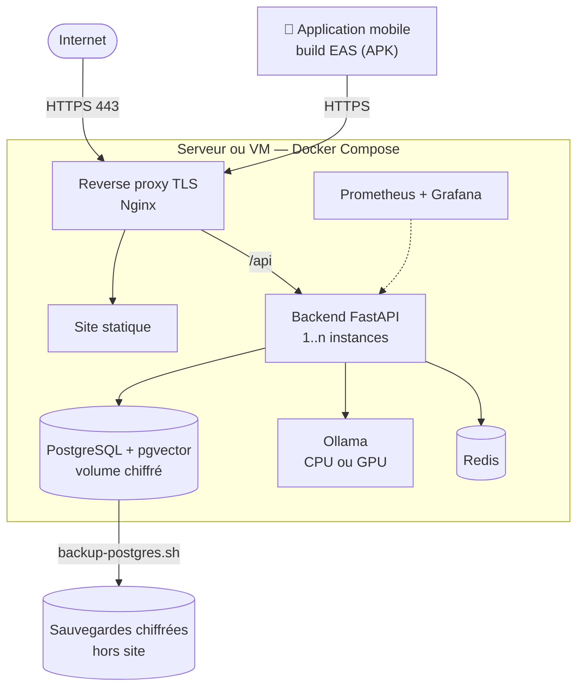

Étapes et bonnes pratiques détaillées : [docs/deployment/README.md](docs/deployment/README.md).

---

## 🗺 Feuille de route

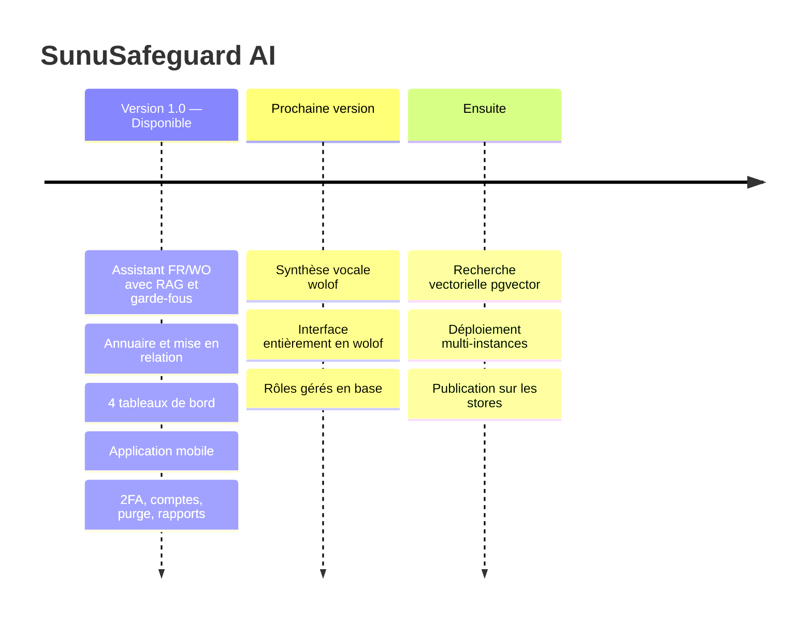

---

## 🧭 Bonnes pratiques d'exploitation

| Domaine | Recommandation |
|---|---|
| Contenus | Faire relire régulièrement `data/knowledge_base/` par des juristes et des professionnel·les psychosociaux |
| Urgences | Tenir à jour les numéros de `data/seed/emergency_contacts.json` |
| Wolof | Faire valider les évolutions du lexique (`ai-engine/multilingual/lexicon.py`) et des messages (`ai-engine/llm/fallback.py`) par des linguistes |
| Règles de sécurité | Revoir `ai-engine/safety/rules.py` avec des professionnel·les à chaque évolution |
| Annuaire | Maintenir structures, coordonnées et conventions de partenariat à jour |
| Données personnelles | Tenir à jour l'analyse d'impact relative à la protection des données |
| Infrastructure | TLS, rotation des secrets, sauvegardes chiffrées, tests d'intrusion réguliers |
| Mineures | Appliquer un protocole spécifique pour ce public |
| Montée en charge | Avec plusieurs instances backend, déplacer la limitation de débit vers Redis |

---

## 📖 Documentation complémentaire

| Document | Contenu |
|---|---|
| [Architecture](docs/architecture/README.md) | Composants et chaîne IA |
| [API](docs/api/README.md) | Familles de routes et exemples |
| [Sécurité et confidentialité](docs/security/README.md) | Garanties et travaux restants |
| [Base de données](docs/database/README.md) | Schéma, migrations, passage à pgvector |
| [Déploiement](docs/deployment/README.md) | Mise en production |
| [Charte UI](docs/user-guides/charte-ui.md) | Couleurs, typographie, composants |
| [Guide de démonstration](docs/user-guides/guide-demo.md) | Scénario de présentation |
| [Guide de l'application mobile](docs/user-guides/guide-app-mobile.md) | Utilisation de « Sunu » |
| [Moteur IA](ai-engine/README.md) | Détails du module `ai-engine` |

---

<div align="center">

**SunuSafeguard AI** — GREEN T SARL, Sénégal

*« Sunu » signifie « notre » en wolof : une plateforme pensée avec et pour les personnes qu'elle protège.*

</div>
