<div align="center">

# SunuSafeguard AI

**An intelligent platform for psychosocial support, referral and protection**

Caring support in French and Wolof · Referral to support organizations · Anonymous impact monitoring

Built by **GREEN T SARL** — Senegal

[Français](README.fr.md) · **English**


</div>

---

## Table of contents

1. [Project overview](#project-overview)
2. [Features](#features)
3. [System architecture](#system-architecture)
4. [The AI engine](#the-ai-engine)
5. [Journey of a conversation](#journey-of-a-conversation)
6. [Referral to a support organization](#referral-to-a-support-organization)
7. [Knowledge base and document validation](#knowledge-base-and-document-validation)
8. [Roles, access and authentication](#roles-access-and-authentication)
9. [Data model](#data-model)
10. [Security and privacy](#security-and-privacy)
11. [Mobile app "Sunu"](#mobile-app-sunu)
12. [Tech stack](#tech-stack)
13. [Repository structure](#repository-structure)
14. [Installation and startup](#installation-and-startup)
15. [Configuration](#configuration)
16. [Test accounts](#test-accounts)
17. [API](#api)
18. [Testing and quality](#testing-and-quality)
19. [Deployment](#deployment)
20. [Roadmap](#roadmap)
21. [Operational best practices](#operational-best-practices)
22. [Further documentation](#further-documentation)

---

## Project overview

Many women and girls in Senegal face violence, psychological distress or emergencies without knowing
**who to talk to** or **where to turn**. SunuSafeguard AI gives them:

| For… | SunuSafeguard provides… |
|---|---|
| **People seeking help** | A conversational assistant available around the clock, in French and Wolof, that listens without judgment, gives reliable and sourced information, detects emergencies and suggests a suitable support organization, **without ever storing the conversation**. |
| **Partner organizations** (listening centers, NGOs, social services) | A space to keep their profile and availability up to date, receive consented referral requests and track how they are handled. |
| **Institutions and funders** | **Strictly anonymous** impact indicators (publication threshold N ≥ 5), regional maps and PDF / Excel reports. |
| **Experts** (lawyers, psychologists, linguists) | A validation workflow for the documents that feed the assistant: nothing is used until it is published. |
| **The GREEN T technical team** | Monitoring of AI quality, performance, safety guardrails, accounts and the audit log. |

### Guiding principles

- **The person's safety comes first**: emergency rules are deterministic and always override the AI.
- **No conversation is ever stored**: not in the database, not in the logs.
- **Never a diagnosis, never a false promise**: an output check replaces any problematic answer.
- **Always sourced**: the assistant only answers from validated documents and cites its sources.
- **Explicit consent** before anything is shared with an organization.
- **Sovereign, free AI**: the language model and speech recognition run locally, with no paid service.

---

## Features

| Area | Content | Status |
|---|---|---|
| **Public interface (website, PWA)** | Home page, conversational assistant in FR / WO, directory of organizations, consented referral, tracking by code, privacy page, **Quick exit button** (and Esc × 2), dark mode by default, mobile-first design | Yes |
| **Mobile app "Sunu"** | Android / iOS (Expo): voice listening, answers, resources, session, **discreet mode** disguised as a calculator | Yes |
| **FastAPI backend** | JWT authentication, server-side role-based access control, lockout after failed attempts, public sign-up, logout with token revocation, OpenAPI docs at `/api/docs` | Yes |
| **AI engine** (`ai-engine/`) | Language detection, needs classification, deterministic guardrails (emergency, prompt injection, out of scope, diagnosis requests), hybrid retrieval (RAG) with cited sources, local LLM through Ollama with an **extractive fallback**, output check | Yes |
| **Sunu Impact** | Key indicators, trends, needs, languages, channels, regional map, PDF / Excel reports, N ≥ 5 threshold | Yes |
| **Sunu Orientation** | Organization profiles, availability and history, validation, referral requests, response times, non-receipt alerts, team management | Yes |
| **Sunu Ressources** | PDF / DOCX / TXT import, chunking, indexing, validation workflow, RAG playground, knowledge gaps, evaluation | Yes |
| **Sunu Tech** | AI quality, latency, guardrails, service health, CPU / RAM, audit log, data purge, Prometheus metrics at `/metrics` | Yes |
| **Accounts and access** | Accounts created with a temporary password, roles, deactivation, reset; a partner manager runs their own organization's team | Yes |
| **Access security** | TOTP two-factor authentication (QR code) required for privileged accounts, password change, rate limiting on login and chat | Yes |
| **Data retention** | Automatic purge every 24 h according to the configured policy, manual purge from Sunu Tech | Yes |
| **Speech recognition** | Local Whisper-small (French and Wolof), CPU only, audio never written to disk | Yes |
| **Wolof text-to-speech** | No free and reliable solution available yet | Next release |

---

## System architecture

### Overview

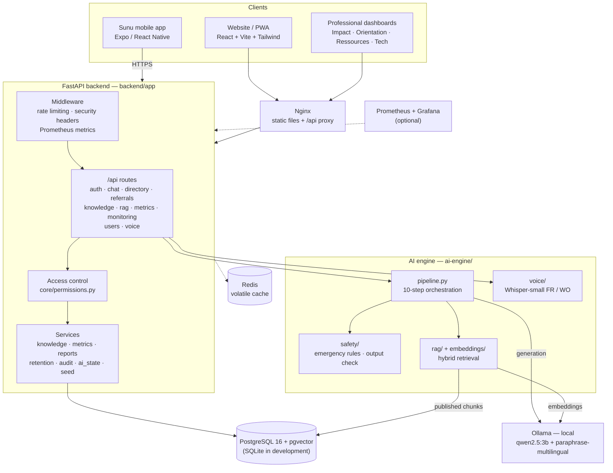

### Backend layers

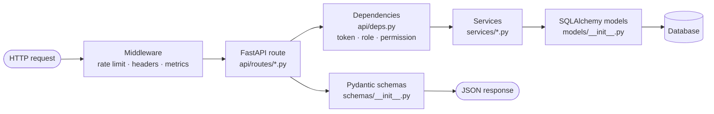

Every route that touches professional data declares the permission it requires with
`require("permission")`. **The API is the source of truth**: the interface hides unauthorized
areas, but the server always refuses access, even to a hand-crafted request.

### Backend startup

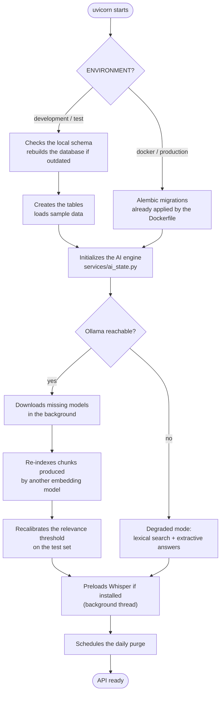

---

## The AI engine

The AI engine (`ai-engine/`) is a standalone Python module called by the backend. It stores
**no conversation data**.

### The 10-step processing chain

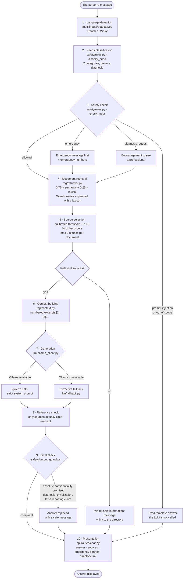

### Step details

| Step | Module | What it does |
|---|---|---|
| 1. Language | `multilingual/detector.py` | French / Wolof heuristic with a confidence score. |
| 2. Need | `safety/rules.py::classify_need` | Keywords → 7 categories: psychosocial support, physical and verbal violence, economic violence, cyberbullying, shelter and protection, legal information, reproductive health. |
| 3. Safety | `safety/rules.py::check_input` | **Deterministic** rules: `urgent`, `refuse_injection`, `out_of_scope`, `redirect_professional`, `allow`. Emergencies always take priority. Distinguishes an emergency affecting the person from one affecting someone else. |
| 4. Retrieval | `rag/retriever.py` | **Hybrid** search: 75 % semantic cosine similarity (Ollama `paraphrase-multilingual`) and 25 % lexical. Lexical-only search when Ollama is absent. Wolof queries are expanded using the `multilingual/lexicon.py` lexicon. |
| 5. Selection | `pipeline.py` | Absolute threshold **calibrated at startup** (`evaluation/calibrate.py`) plus a relative threshold (≥ 60 % of the best score). Stricter threshold during emergencies. |
| 6. Context | `rag/context.py` | Numbered excerpts passed to the model. |
| 7. Generation | `llm/ollama_client.py` | `qwen2.5:3b` by default, strict system prompt (`llm/prompts.py`). The user's text is delimited to prevent injection. |
| 8. References | `pipeline.py` | Only the sources actually cited are returned. |
| 9. Final check | `safety/output_guard.py` | Replaces any answer that promises absolute confidentiality, makes a diagnosis, trivializes violence or claims a report was filed. |
| 10. Presentation | `backend/app/api/routes/chat.py` | Answer, sources, emergency banner, directory suggestion. |

### Running without the model

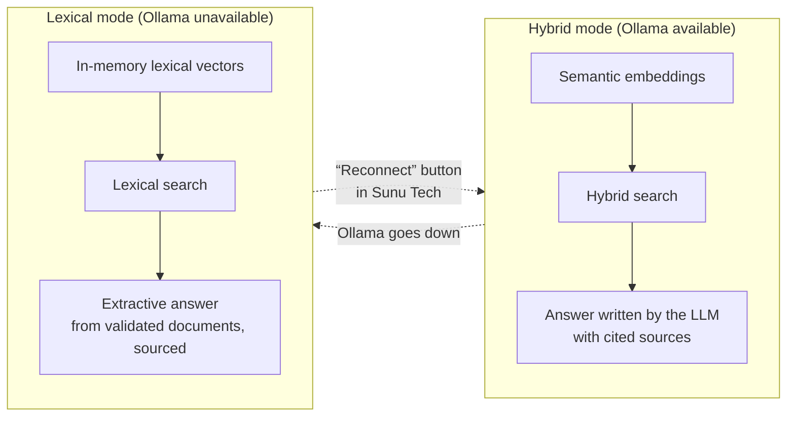

The assistant **always stays available**. The engine state (mode, model, threshold, downloads)
is shown in **Sunu Tech → RAG & AI performance** and exposed by `GET /api/monitoring/ai-engine`.

### Wolof

Small open-source models do not handle Wolof well yet. Rather than produce approximate Wolof, the
assistant answers in **plain French**, preceded by a Wolof sentence from a validated template
(`llm/fallback.py`). Wolof speech recognition uses a Whisper-small model fine-tuned on 57 hours of
Wolof (`M9and2M/whisper-small-wolof`, MIT license).

---

## Journey of a conversation

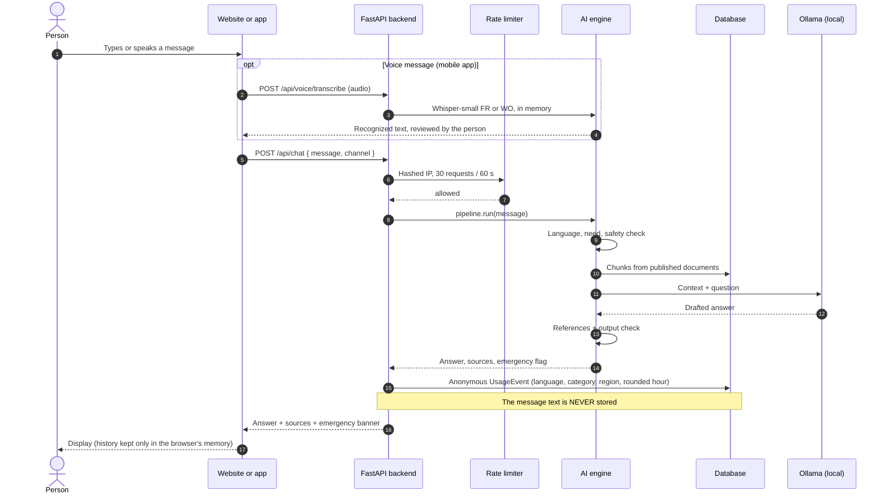

---

## Referral to a support organization

A referral is only created **with the person's explicit consent**. Their contact details are
**encrypted** (Fernet) and **erased** as soon as the request is closed.

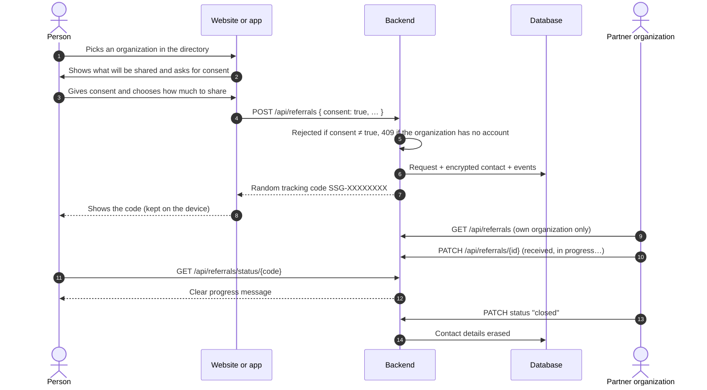

### Lifecycle of a request

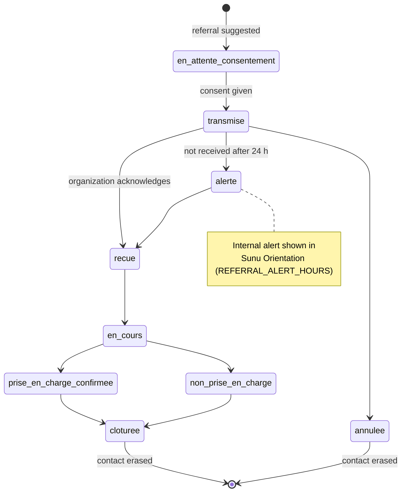

| Status | Meaning |
|---|---|
| `en_attente_consentement` | Referral suggested, waiting for consent |
| `transmise` | Sent to the organization |
| `recue` | Received by the organization |
| `en_cours` | Being handled |
| `prise_en_charge_confirmee` | Support confirmed |
| `non_prise_en_charge` | The organization could not follow up |
| `cloturee` / `annulee` | Closed / cancelled |

---

## Knowledge base and document validation

Only documents with the **published** status feed the assistant. Each document goes through a
traceable validation workflow (versions, reviews, audit).

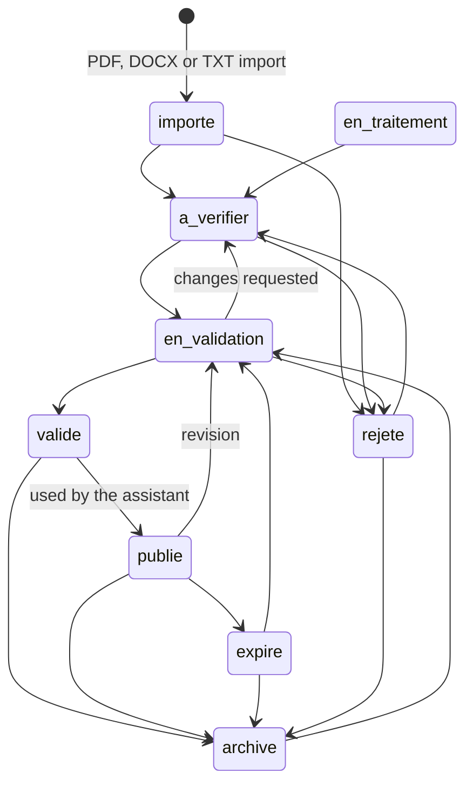

| Status | Meaning |
|---|---|
| `importe` | Imported |
| `en_traitement` | Being processed |
| `a_verifier` | To be checked |
| `en_validation` | Under expert review |
| `valide` | Validated |
| `publie` | Published, used by the assistant |
| `expire` | Expired, needs review |
| `archive` | Archived |
| `rejete` | Rejected |

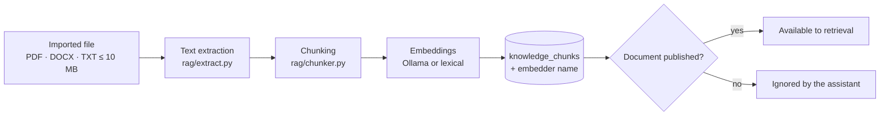

Included content (`data/knowledge_base/`, in French): psychosocial support, domestic violence and
rights, cyberbullying, economic violence, shelter and referral, reproductive health, well-being,
stress, supporting a loved one, suicidal thoughts, resources in Senegal, confidentiality.

---

## Roles, access and authentication

### Main profiles

The platform is built around three main profiles:

| Profile | Technical role | Can | Cannot |
|---|---|---|---|
| **User** | `utilisateur` | Use the assistant and the directory, create an account through public sign-up, track their own requests (`GET /api/referrals/mine`) | Access any admin area ("Access denied") |
| **Operations administrator** | `admin_operationnel` | Resources, directory, referrals, impact indicators, reports, across all organizations | Manage accounts, see technical monitoring |
| **GREEN T super administrator** | `super_admin` | Everything: accounts and roles, technical configuration, monitoring, logs | — |

Finer-grained roles are also available: technical administrator, institutional manager, analyst,
partner manager, social worker, document expert, linguistic expert.

### Dashboard access matrix

| Dashboard | super_admin | admin_operationnel | admin_technique | institutional / analyst | partner / social worker | experts | utilisateur |
|---|:---:|:---:|:---:|:---:|:---:|:---:|:---:|
| Sunu Impact | Yes | Yes | | Yes | | | |
| Sunu Orientation | Yes | Yes | | | Yes *(own organization)* | | |
| Sunu Ressources | Yes | Yes | | | | Yes | |
| Sunu Tech | Yes | | Yes | | | | |
| Account management | Yes | | | | Yes *(manager, own organization)* | | |

The full permission matrix is versioned in
[`backend/app/core/permissions.py`](backend/app/core/permissions.py), which makes it auditable.

### Sign-in with two-factor authentication

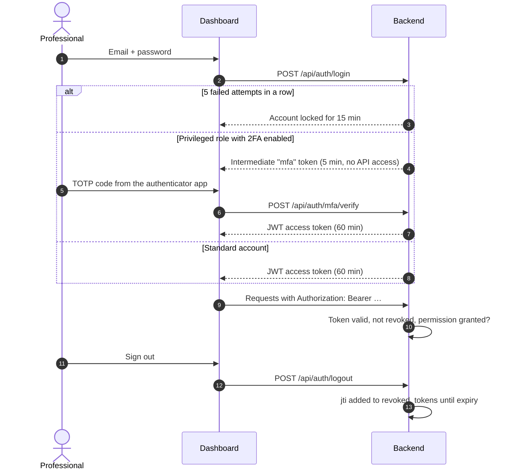

---

## Data model

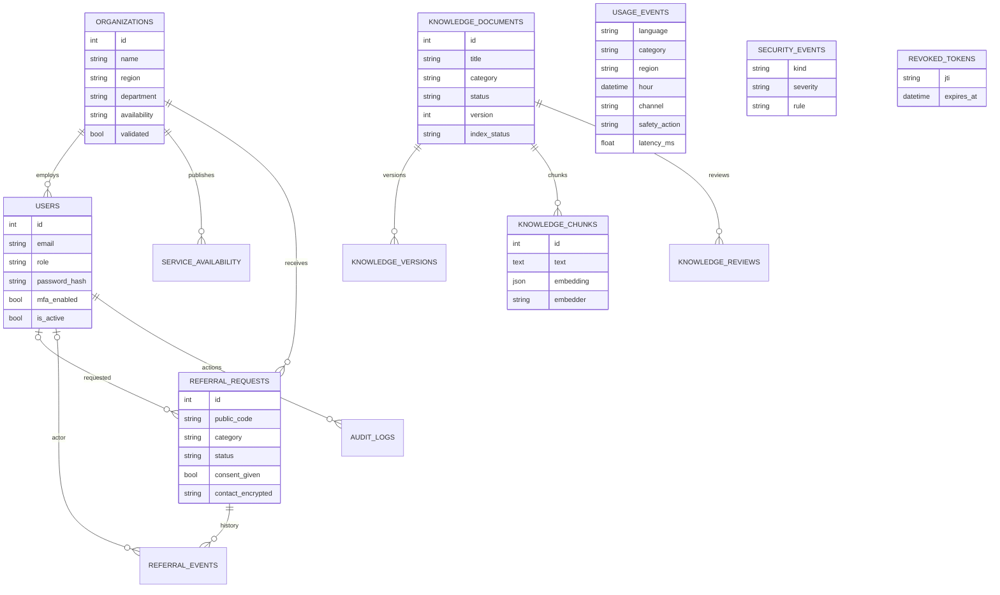

Other tables: `rag_evaluations`, `ai_model_configurations`, `safety_rules`, `aggregate_metrics`,
`reports`. The full schema lives in [`backend/app/models/__init__.py`](backend/app/models/__init__.py)
and the Alembic migrations in [`backend/migrations/versions/`](backend/migrations/versions/).

> [!NOTE]
> `USAGE_EVENTS` is the only source for indicators: language, category, **self-reported** region,
> channel and **rounded** hour. No session identifier, no text.

---

## Security and privacy

### What the code guarantees

| Requirement | Implementation | Verified by |
|---|---|---|
| Conversations never stored | No table stores the text; history kept in `sessionStorage` (web) or in memory (mobile) | `test_chat_never_stores_message_text` |
| Logs without sensitive content | `SecurityEvent` only keeps the triggered rule; Nginx `access_log off` | same |
| Anonymous statistics | `UsageEvent` without any session identifier | — |
| Publication threshold N ≥ 5 | `services/metrics.py::suppress`, also in the Excel export | `test_k_anonymity_suppression` |
| Consent before sharing | `POST /api/referrals` refuses without `consent=true` | `test_referral_requires_consent` |
| Non-linkable tracking code | Random `SSG-XXXXXXXX` code | — |
| Encrypted referral data | Fernet (`DATA_ENCRYPTION_KEY`), erased on closure | — |
| Partner isolation | Server-side filtering on `organization_id` | `test_partner_isolation` |
| Server-side access control | `require(permission)` on every route | `test_dashboard_permissions` |
| Unprivileged public sign-up | `utilisateur` role enforced by the server | `test_roles.py` |
| Real logout | Token revoked (`revoked_tokens`) | `test_roles.py` |
| Brute-force protection | 15-min lockout after 5 failures + rate limiting by hashed IP | `test_rate_limit_on_chat` |
| Two-factor authentication | TOTP (RFC 6238) required for `super_admin` and `admin_technique` | `test_mfa_enrolment_and_login` |
| Retention and purge | Daily + manual purge | `test_retention_purge` |
| No automatic reporting | No outbound integration; output check | `test_output_guard` |
| Prompt injection | Deterministic rules + system instructions + delimited text | `test_prompt_injection_refused` |
| Unvalidated documents excluded | Only the `publie` status is loaded | `test_unpublished_document_not_used` |
| HTTP headers | `nosniff`, `X-Frame-Options: DENY`, `no-referrer`, `Cache-Control: no-store` | — |
| Quick exit | Button on every screen, Esc × 2, clears the session, `location.replace` | — |

### Default retention periods

| Data | Period | Variable |
|---|---|---|
| Anonymous usage events | 395 days | `RETENTION_USAGE_DAYS` |
| Security events | 180 days | `RETENTION_SECURITY_DAYS` |
| Audit log | 730 days | `RETENTION_AUDIT_DAYS` |
| Referral requests | 365 days | `RETENTION_REFERRAL_DAYS` |

### What flows and what never does

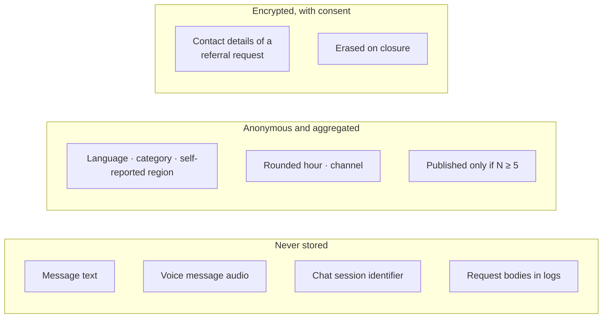

---

## Mobile app "Sunu"

Android / iOS app in [`frontend/mobile/`](frontend/mobile/), connected to the same API, with the
same design as the website (Teranga palette, dark theme by default).

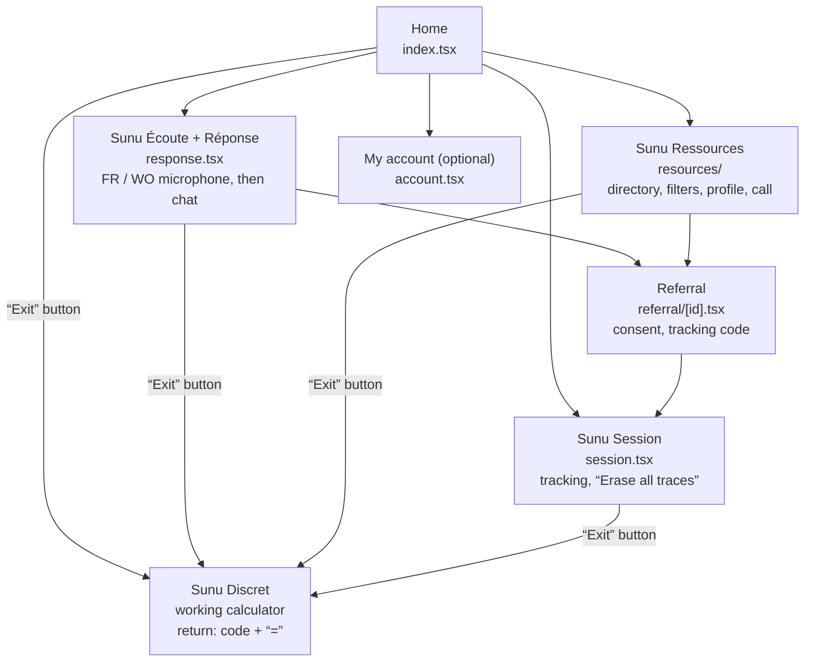

| On-device protection | Details |
|---|---|
| Conversation | In memory only, erased on close, on "Exit" or on erase |
| Tracking codes and settings | System encrypted storage (`expo-secure-store`); closed requests erased after 30 days, any request after 180 days |
| Offline directory | Local copy of the public directory (no personal data) |
| Discretion | Android: screen hidden in recent apps and screenshots blocked; iOS: blurred in the app switcher |
| Microphone | Turned off in the background and on "Exit"; the only permission requested |
| Notifications | None |

Running, building for Android and testing: see [`frontend/mobile/README.md`](frontend/mobile/README.md)
and the [user guide](docs/user-guides/guide-app-mobile.md) (in French).

---

## Tech stack

| Layer | Technologies |
|---|---|
| **Website** | React 18, TypeScript, Vite 5, Tailwind CSS 3, Recharts, PWA (service worker) |
| **Mobile** | Expo SDK 58, React Native, Expo Router, TypeScript, Zustand, expo-secure-store, expo-speech |
| **Backend** | Python 3.11+, FastAPI, SQLAlchemy 2, Alembic, Pydantic 2, PyJWT, cryptography (Fernet) |
| **Documents and reports** | pypdf, python-docx, openpyxl, fpdf2 |
| **AI** | Ollama (`qwen2.5:3b`, `paraphrase-multilingual`), in-house hybrid RAG, deterministic guardrails |
| **Voice** | Transformers + PyAV, Whisper-small (FR) and Whisper-small Wolof, CPU only |
| **Data** | PostgreSQL 16 + pgvector (production), SQLite (development), Redis (volatile cache) |
| **Operations** | Docker Compose, Nginx, Prometheus, Grafana, psutil |
| **Testing** | pytest, Jest, TypeScript type checking |

---

## Repository structure

```text
SUNUSAFEGUARD/
├── ai-engine/                 AI engine (Python, independent from the web layer)
│   ├── pipeline.py            10-step chain orchestration
│   ├── safety/                Emergency rules, classification, output check, PII
│   ├── rag/                   Extraction, chunking, context, hybrid retrieval
│   ├── embeddings/            Ollama and lexical (hashing) embeddings
│   ├── llm/                   Ollama client, prompts, extractive fallback, templates
│   ├── multilingual/          Language detection, Wolof lexicon
│   ├── evaluation/            RAG evaluation, threshold calibration
│   └── voice/                 Whisper speech recognition
├── backend/                   FastAPI API
│   ├── app/
│   │   ├── main.py            Application, middleware, startup, scheduled purge
│   │   ├── api/routes/        auth, chat, directory, referrals, knowledge, rag,
│   │   │                      metrics, monitoring, users, voice
│   │   ├── core/              config, permissions (RBAC), security, TOTP, rate limit
│   │   ├── models/            SQLAlchemy models
│   │   ├── schemas/           Pydantic schemas
│   │   ├── services/          Knowledge, metrics, reports, retention, audit
│   │   └── cli.py             Commands: seed, evaluate, ai-status, import-orgs…
│   ├── migrations/            Alembic migrations
│   └── tests/                 pytest tests
├── frontend/                  React website (public + professional dashboards)
│   ├── src/pages/public/      Home, Chat, Directory, Login, Privacy
│   ├── src/pages/dashboards/  Impact, Orientation, Ressources, Tech, Account
│   └── mobile/                "Sunu" Expo mobile app
├── data/
│   ├── knowledge_base/        Assistant source documents (Markdown)
│   ├── seed/                  Accounts, organizations, emergency numbers
│   ├── evaluation/            RAG test set
│   └── fixtures/              Sample files for import
├── infrastructure/            Website Dockerfile, Nginx, PostgreSQL, Prometheus, backups
├── docs/                      Architecture, API, security, database, deployment, guides
├── scripts/                   Local startup (Windows, Unix), smoke test
├── docker-compose.yml
├── Makefile
└── .env.example
```

---

## Installation and startup

### Prerequisites

| Tool | Version | Required |
|---|---|---|
| Python | 3.11 or later | Yes |
| Node.js | 20 or later | Yes |
| Ollama | recent | No: without it, the assistant answers with extracts |
| Docker + Docker Compose | recent | Only for the full stack |

### Option 1 — Local startup without Docker

**Windows (PowerShell)**

```powershell
git clone https://github.com/Dioumadev221/SUNUSAFEGUARD.git
cd SUNUSAFEGUARD
copy .env.example .env
.\scripts\dev.ps1
```

**Linux / macOS / WSL**

```bash
git clone https://github.com/Dioumadev221/SUNUSAFEGUARD.git
cd SUNUSAFEGUARD
cp .env.example .env
make install    # once
make backend    # terminal 1 → http://localhost:8000/api/docs
make frontend   # terminal 2 → http://localhost:5173
```

On first startup, a SQLite database is created and filled with sample data: indexed documents,
organizations, accounts and **synthetic** activity for the charts.

### Option 2 — Full stack with Docker

```bash
cp .env.example .env          # then change JWT_SECRET, DATA_ENCRYPTION_KEY and passwords
docker compose up -d --build  # http://localhost:8080
docker compose --profile monitoring up -d   # adds Prometheus :9090 and Grafana :3000
```

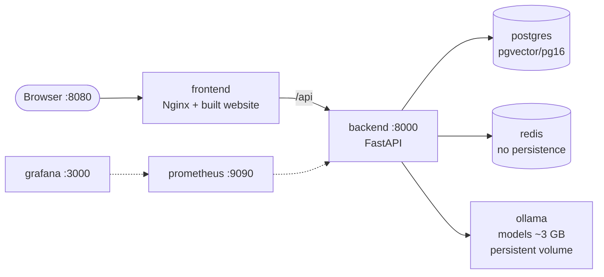

### Enabling generative AI (Ollama)

| Purpose | Default model | Size | Variable |
|---|---|---|---|
| Writing answers | `qwen2.5:3b` | ~2 GB | `OLLAMA_MODEL` |
| Semantic embeddings (FR + approximate Wolof) | `paraphrase-multilingual` | ~0.6 GB | `EMBEDDING_MODEL` |

1. Install Ollama (Windows: `winget install Ollama.Ollama`).
2. Start the backend: missing models are **downloaded automatically in the background**
   (`OLLAMA_AUTO_PULL=true`), documents are re-indexed and the threshold recalibrated.
3. Check the status: `python -m app.cli ai-status` (from `backend/`).

### Enabling speech recognition (optional)

```bash
cd backend
pip install --index-url https://download.pytorch.org/whl/cpu torch
pip install -r requirements-voice.txt
```

Whisper models (~1 GB) are downloaded once from Hugging Face on first use.

### Running the mobile app

```powershell
.\scripts\dev-mobile.ps1      # API reachable over Wi-Fi (port 8001) + Expo
```

Then open Expo Go on a phone connected to the same Wi-Fi network. Details in
[`frontend/mobile/README.md`](frontend/mobile/README.md).

### Useful commands

| Command | Effect |
|---|---|
| `make test` | Backend + AI tests, then website TypeScript check |
| `make eval` | RAG evaluation on `data/evaluation/rag_testset.json` |
| `make seed` | Reloads sample data |
| `make llm-local` | Downloads the models into a local Ollama |
| `make docker-up` / `make docker-down` | Starts / stops the Docker stack |
| `python -m app.cli import-orgs <file> --hide-demo` | Imports real organizations and hides the sample ones |

---

## Configuration

All configuration goes through environment variables (`.env` file, template in
[`.env.example`](.env.example)). **Never commit `.env`.**

| Group | Variable | Default | Purpose |
|---|---|---|---|
| Application | `ENVIRONMENT` | `development` | `development` creates the tables and sample data |
| | `CORS_ORIGINS` | `http://localhost:5173,http://localhost:8080` | Allowed origins |
| Database | `DATABASE_URL` | local SQLite | PostgreSQL URL in production |
| Security | `JWT_SECRET` | *must be changed* | Token signing secret |
| | `JWT_EXPIRE_MINUTES` | `60` | Token lifetime |
| | `DATA_ENCRYPTION_KEY` | *empty* | Fernet key for referral data |
| | `DEMO_PASSWORD` | `SunuDemo2026!` | Password of the test accounts |
| AI | `LLM_PROVIDER` | `ollama` | `ollama` or `none` (extractive answers only) |
| | `OLLAMA_URL` | `http://127.0.0.1:11434` | Ollama address (IPv4 avoids ~2 s of latency on Windows) |
| | `OLLAMA_MODEL` | `qwen2.5:3b` | Generation model |
| | `OLLAMA_AUTO_PULL` | `true` | Automatic model download |
| | `EMBEDDING_PROVIDER` | `auto` | `auto`, `ollama` or `hashing` |
| | `EMBEDDING_MODEL` | `paraphrase-multilingual` | Embedding model |
| | `RAG_MIN_SCORE` | *calibrated* | Fixed threshold (leave empty for automatic calibration) |
| | `RAG_TOP_K` | `4` | Number of chunks retrieved |
| Privacy | `K_ANONYMITY_THRESHOLD` | `5` | Indicator publication threshold |
| | `RETENTION_*_DAYS` | see above | Retention periods |
| Protection | `RATE_LIMIT_CHAT` | `30/60` | Requests per window in seconds |
| | `RATE_LIMIT_LOGIN` | `10/60` | Same for login |
| Referrals | `REFERRAL_ALERT_HOURS` | `24` | Delay before a non-receipt alert |

Generate an encryption key:

```bash
python -c "from cryptography.fernet import Fernet; print(Fernet.generate_key().decode())"
```

---

## Test accounts

Shared password: `SunuDemo2026!` (variable `DEMO_PASSWORD`). These accounts are meant for
development and test environments.

| Email | Profile | Access |
|---|---|---|
| `superadmin@sunusafeguard.local` | GREEN T super administrator | All dashboards, accounts, monitoring |
| `operationnel@sunusafeguard.local` | Operations administrator | Impact, Orientation, Ressources |
| `utilisateur@sunusafeguard.local` | Test user (Awa) | No admin area |
| `utilisateur2@sunusafeguard.local` | Test user (Fatou) | No admin area |
| `tech@sunusafeguard.local` | Technical administrator | Sunu Tech |
| `impact@…` / `analyste@…` | Institutional manager / Analyst | Sunu Impact |
| `partenaire@…` / `social@…` | Partner manager / Social worker | Sunu Orientation, own organization only |
| `expert@…` / `linguiste@…` | Document / linguistic experts | Sunu Ressources |

`super_admin` and `admin_technique` accounts are prompted to enable two-factor authentication
("My account" page); once enabled, a code is required at every sign-in.

---

## API

Interactive OpenAPI documentation: **http://localhost:8000/api/docs**

| Group | Main routes | Access |
|---|---|---|
| Authentication | `POST /api/auth/login`, `/register`, `/logout`, `/mfa/setup`, `/mfa/enable`, `/mfa/verify`, `/password`, `GET /api/auth/me` | public / signed in |
| Chat | `POST /api/chat`, `GET /api/emergency-contacts` | public |
| Voice | `POST /api/voice/transcribe`, `POST /api/voice/transcribe-base64` | public |
| Directory | `GET /api/directory`, `GET /api/directory/manage`, `POST` / `PUT /api/directory`, `POST /api/directory/{id}/availability`, `/validate`, `GET …/history` | public (validated) / partners / administrators |
| Referrals | `POST /api/referrals`, `GET /api/referrals/status/{code}`, `GET /api/referrals/mine`, `GET /api/referrals`, `PATCH /api/referrals/{id}`, `GET /api/referrals/stats`, `GET /api/referrals/alerts` | public / user / organization |
| Knowledge | `GET` / `POST /api/knowledge/documents`, `GET …/{id}`, `PATCH …/{id}/status`, `POST …/{id}/reindex` | experts |
| RAG | `POST /api/rag/playground`, `POST /api/rag/evaluate`, `GET /api/rag/evaluations`, `GET /api/rag/gaps` | experts, technical |
| Metrics and reports | `GET /api/metrics/overview`, `GET /api/metrics/geo`, `GET /api/reports`, `GET /api/reports/export` | Sunu Impact |
| Accounts | `GET` / `POST /api/users`, `GET /api/users/roles`, `PATCH /api/users/{id}`, `POST /api/users/{id}/reset` | super admin / partner manager |
| Monitoring | `GET /api/health`, `/api/monitoring/services`, `/ai`, `/security`, `/retention`, `/ai-engine`, `POST …/retention/purge`, `POST …/ai-engine/reconnect`, `GET /api/audit`, `GET /metrics` | Sunu Tech |

Example:

```bash
curl -X POST http://localhost:8000/api/chat \
     -H "Content-Type: application/json" \
     -d '{"message": "Mën naa am ndimbal ?"}'
```

---

## Testing and quality

```bash
make test   # pytest (backend + AI engine) then TypeScript check
make eval   # RAG evaluation
```

| Suite | File | What is checked |
|---|---|---|
| AI engine | `backend/tests/test_ai_engine.py` | Guardrails, language detection, output check, prompt injection |
| API | `backend/tests/test_api.py` | Access control, partner isolation, N ≥ 5 threshold, consent, messages never stored |
| Hybrid retrieval | `backend/tests/test_hybrid.py` | Hybrid score, lexical fallback, calibration |
| Accounts and operations | `backend/tests/test_phase2.py` | Accounts, 2FA, rate limiting, PDF / Excel reports, purge |
| Mobile (server) | `backend/tests/test_mobile.py` | Mobile channel, voice API limits |
| Roles | `backend/tests/test_roles.py` | Sign-up, 3 profiles, logout, requests linked to the account |
| Mobile (app) | `frontend/mobile/tests/logic.test.ts` | Calculator, availability, local retention, text-to-speech |

RAG evaluation results on the reference set (14 cases): **recall@4 = 93 %**, **MRR = 0.82**.

An end-to-end smoke test is available in `scripts/smoke_test.py`.

---

## Deployment

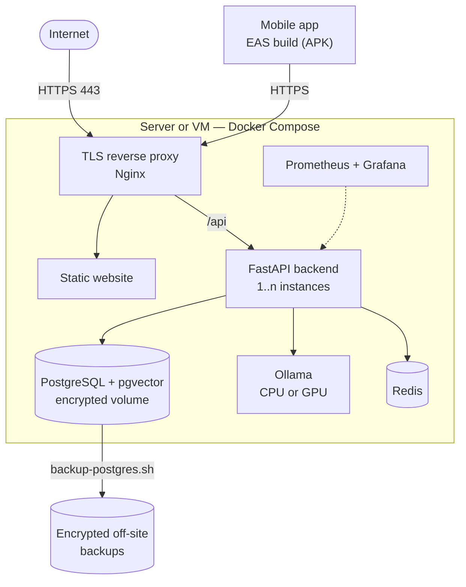

Detailed steps and best practices: [docs/deployment/README.md](docs/deployment/README.md) (in French).

---

## Roadmap

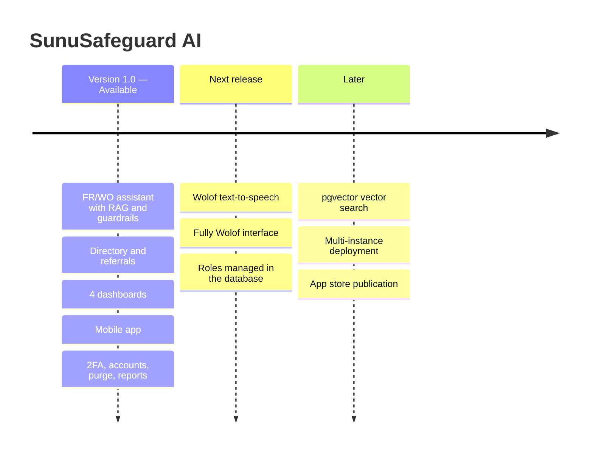

---

## Operational best practices

| Area | Recommendation |
|---|---|
| Content | Have `data/knowledge_base/` reviewed regularly by lawyers and psychosocial professionals |
| Emergencies | Keep the numbers in `data/seed/emergency_contacts.json` up to date |
| Wolof | Have changes to the lexicon (`ai-engine/multilingual/lexicon.py`) and messages (`ai-engine/llm/fallback.py`) validated by linguists |
| Safety rules | Review `ai-engine/safety/rules.py` with professionals whenever it changes |
| Directory | Keep organizations, contact details and partnership agreements up to date |
| Personal data | Keep the data protection impact assessment up to date |
| Infrastructure | TLS, secret rotation, encrypted backups, regular penetration tests |
| Minors | Apply a dedicated protocol for this audience |
| Scaling | With several backend instances, move rate limiting to Redis |

---

## Further documentation

The detailed documents below are written in French.

| Document | Content |
|---|---|
| [Architecture](docs/architecture/README.md) | Components and AI chain |
| [API](docs/api/README.md) | Route groups and examples |
| [Security and privacy](docs/security/README.md) | Guarantees and remaining work |
| [Database](docs/database/README.md) | Schema, migrations, moving to pgvector |
| [Deployment](docs/deployment/README.md) | Going to production |
| [UI guidelines](docs/user-guides/charte-ui.md) | Colors, typography, components |
| [Presentation guide](docs/user-guides/guide-demo.md) | Presentation walkthrough |
| [Mobile app guide](docs/user-guides/guide-app-mobile.md) | Using "Sunu" |
| [AI engine](ai-engine/README.md) | Details of the `ai-engine` module |

---

<div align="center">

**SunuSafeguard AI** — GREEN T SARL, Senegal

*"Sunu" means "our" in Wolof: a platform designed with and for the people it protects.*

</div>
