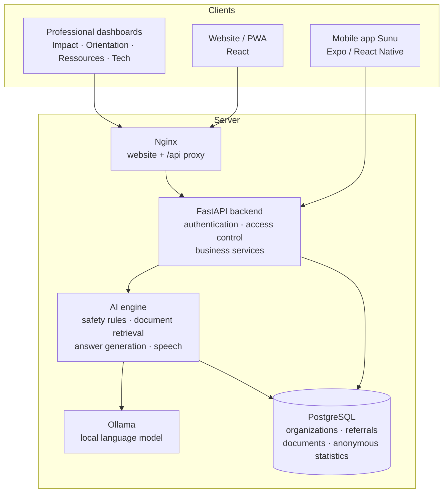
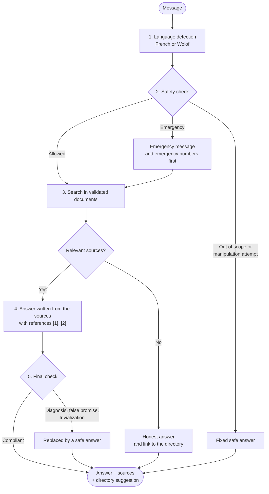
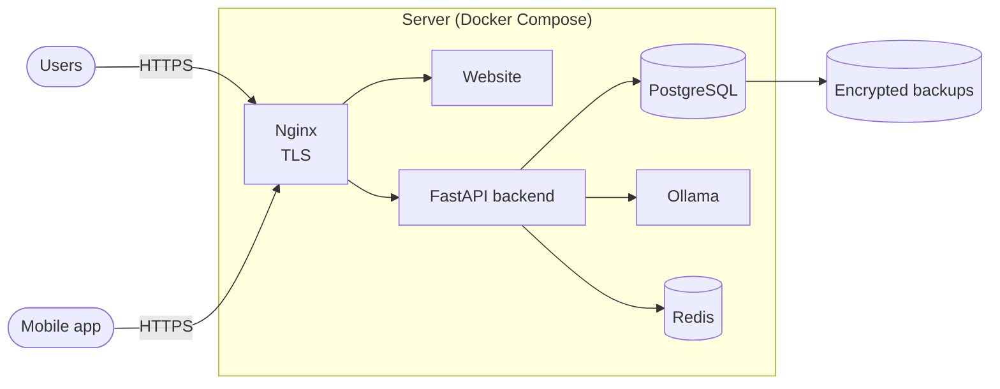

<div align="center">

# SunuSafeguard AI

**An intelligent platform for psychosocial support, referral and protection**

Caring support in French and Wolof · Referral to support organizations · Anonymous impact monitoring

Built by **GREEN T SARL**, Senegal

[Français](README.fr.md) · **English**


</div>

---

## Table of contents

1. [Overview](#overview)
2. [Features](#features)
3. [Architecture](#architecture)
4. [How the assistant works](#how-the-assistant-works)
5. [User guide](#user-guide)
6. [Roles and access](#roles-and-access)
7. [Security and privacy](#security-and-privacy)
8. [Installation](#installation)
9. [Configuration](#configuration)
10. [Test accounts](#test-accounts)
11. [API](#api)
12. [Testing](#testing)
13. [Deployment](#deployment)
14. [Repository structure](#repository-structure)
15. [Roadmap](#roadmap)
16. [Operational best practices](#operational-best-practices)
17. [Further documentation](#further-documentation)

---

## Overview

Many women and girls in Senegal face violence, psychological distress or emergencies without knowing
who to talk to or where to turn. SunuSafeguard AI brings together, in one platform:

- **a conversational assistant** available day and night, in French and Wolof, that listens without
  judgment, gives reliable information with its sources, and recognizes emergencies;
- **a directory of support organizations** (listening centers, legal aid, shelters, health services)
  with a consent-based referral process;
- **professional dashboards** for partner organizations, content experts, institutions and the
  technical team.

The platform is built on six principles:

| Principle | In practice |
|---|---|
| Safety first | Emergency rules are deterministic and always take priority over the AI. |
| No conversation stored | Messages are never saved, neither in the database nor in the logs. |
| No diagnosis, no false promise | A final check replaces any answer that crosses these lines. |
| Always sourced | The assistant only answers from documents validated by experts, and cites them. |
| Explicit consent | Nothing is sent to an organization without the person's clear agreement. |
| Sovereign AI | The language model and speech recognition run locally, with no paid third-party service. |

---

## Features

| Component | What it offers |
|---|---|
| **Public website** | Conversational assistant (French / Wolof), directory of organizations, consent-based referral, request tracking by code, privacy page, Quick exit button, installable on a phone (PWA) |
| **Mobile app "Sunu"** | Android and iOS app with voice input, answers, resources, request tracking and a discreet mode disguised as a calculator |
| **Sunu Impact** | Anonymous indicators, trends, needs, languages, regional map, PDF and Excel reports |
| **Sunu Orientation** | Organization profiles, availability, incoming referral requests, response times, team management |
| **Sunu Ressources** | Document import, expert validation workflow, publication, assistant testing, evaluation |
| **Sunu Tech** | AI quality and performance, service health, security events, audit log, accounts, data purge |
| **Security** | Role-based access enforced by the server, two-factor authentication, account lockout, rate limiting, encryption of referral data, automatic data purge |
| **Speech recognition** | Local Whisper models for French and Wolof; audio is never written to disk |

---

## Architecture



| Component | Role | Location |
|---|---|---|
| Website | Public interface and professional dashboards | `frontend/` |
| Mobile app | Android / iOS app connected to the same API | `frontend/mobile/` |
| Backend | REST API, authentication, permissions, business logic | `backend/` |
| AI engine | Language detection, safety rules, document retrieval, generation, speech recognition | `ai-engine/` |
| Language model | Local Ollama server (`qwen2.5:3b` for answers, `paraphrase-multilingual` for search) | external service |
| Database | PostgreSQL in production, SQLite for local development | `backend/migrations/` |

Access control is always enforced by the API: the interface hides what a user is not allowed to
see, and the server refuses any unauthorized request.

---

## How the assistant works

Every message goes through the same chain of checks before an answer is shown.



| Step | What happens |
|---|---|
| Language detection | The message is identified as French or Wolof. Wolof questions are enriched with a lexicon to improve search. |
| Safety check | Deterministic rules detect emergencies (including when someone else is in danger), manipulation attempts, out-of-scope requests and diagnosis requests. Emergencies always come first. |
| Document search | Hybrid search: 75 % meaning, 25 % keywords. Only documents **published** by experts are used. |
| Answer | The local model writes an answer from the sources found. If the model is unavailable, the assistant answers with extracts from the documents, so it never stops working. |
| Final check | Any answer that would make a diagnosis, promise absolute confidentiality, trivialize violence or claim a report was filed is replaced. |

The message text is never stored. Only anonymous statistics are kept: language, category of need,
self-reported region, channel and rounded hour.

---

## User guide

### For people seeking help (website)

**Talk to the assistant**

1. Open the website and click **"Essayer maintenant"** (Try now), or go to the chat page.
2. Type your message in French or Wolof. No name or personal information is required.
3. Read the answer and its sources. If the situation is urgent, emergency numbers appear at the top.
4. The conversation is kept only in your browser and disappears when you close the tab.

**Find an organization**

1. Open the directory (**"Voir les structures"**).
2. Filter by region (**"Toutes les régions"**) and by type of need (**"Type de besoin"**).
3. Open an organization to see its services, hours, access conditions and availability.
4. Use **"Appeler"** (Call) to contact it directly.

**Ask to be contacted by an organization**

1. On an organization's card, choose **"Être rappelée"** (Ask for a callback). This button appears
   for organizations that receive requests through the platform.
2. Read what will be shared, enter a safe way to reach you, and give your consent.
3. Click **"Transmettre"** (Send). A tracking code such as `SSG-XXXXXXXX` is displayed: keep it.
4. Later, use **"Suivre avec votre code"** (Track with your code) to see the progress of your request.

**Leave quickly**

The red **Quick exit** button is on every page. It can also be triggered by pressing **Esc twice**.
It clears the conversation and replaces the page with a neutral website, without leaving a trace in
the browser history.

### For people seeking help (mobile app "Sunu")

| Screen | How to use it |
|---|---|
| **Home** | Access the assistant, the directory, topics and emergency numbers. |
| **Sunu Écoute** (Listen) | Press the microphone, speak in French or Wolof, check the recognized text, then send it. |
| **Sunu Ressources** | Search the directory by region, department or need; call an organization; the directory also works offline. |
| **Referral** | Choose what to share, give consent, receive a tracking code. |
| **Sunu Session** | Follow your requests, and use **"Effacer toute trace"** (Erase all traces) to clear everything stored on the phone. |
| **Sunu Discret** | The **"Sortir"** (Exit) button turns the app into a working calculator. To come back, type your code followed by **"="** (default code `1234`). |

### For professionals

**Sign in**

1. Go to the **"Espace pro"** page (`/pro`) and sign in with your professional email and password.
2. If two-factor authentication is enabled on your account, enter the 6-digit code from your
   authenticator app.
3. On first sign-in with a temporary password, you are asked to choose a new one.
4. You only see the dashboards your role allows. Sign out with **"Se déconnecter"**.

**Enable two-factor authentication** (required for super administrators and technical administrators)

1. Open **"Mon compte"** (My account), section **"Double authentification"**.
2. Click **"Configurer"** and scan the QR code with an authenticator app (Google Authenticator,
   Microsoft Authenticator, etc.).
3. Enter the code shown by the app and click **"Activer"**.

**Manage the directory and referrals** (Sunu Orientation)

| Task | Procedure |
|---|---|
| Add an organization | **"Nouvelle structure"** → fill in name, region, department, contact, services, hours → **"Enregistrer"**. A new organization stays hidden from the public until it is validated. |
| Validate an organization | Open the organization → **"Valider"**. It then appears in the public directory. |
| Update availability | Open the organization → set availability and capacity → save. Every change is kept in the history. |
| Handle a referral request | Open the request list → open a request → update its status step by step (received, in progress, support confirmed or not, closed). The person sees each update with their tracking code. |
| Watch delays | The dashboard shows median response times and alerts for requests not received after 24 hours. |

**Manage the assistant's knowledge** (Sunu Ressources)

1. Click **"Importer un document"**, choose a PDF, DOCX, TXT or MD file (10 MB maximum), fill in
   title, category, language and source, then **"Importer et indexer"**.
2. The document moves through the review steps: to check, under review, validated.
3. Once **published**, it is immediately used by the assistant. Unpublished documents are never used.
4. Use the test area (**"Tester"**) to ask a question and see which extracts the assistant would use.
5. Use **"Lancer l'évaluation"** to measure search quality on the reference question set, and the
   gaps view to find topics the documents do not cover.

**Follow the impact** (Sunu Impact)

1. Choose the period and granularity to see interactions, needs, languages, channels and the
   regional map.
2. Click **"Générer un rapport d'impact"**, then download the **"Rapport PDF"** or the
   **"Données Excel"**.
3. Any figure based on fewer than 5 cases is hidden to protect anonymity.

**Supervise the platform** (Sunu Tech)

| Task | Procedure |
|---|---|
| Check service health | **"État des services"**: database, AI engine, speech recognition, CPU and memory. |
| Check the AI engine | View the mode (hybrid or lexical), model, relevance threshold and response times. **"Reconnecter"** restarts the connection to the language model. |
| Review security | Emergency escalations, manipulation attempts, failed logins, locked accounts. |
| Read the audit log | **"Journal d'administration"** lists every administrative action. |
| Purge data | **"Lancer la purge maintenant"** applies the retention policy immediately (it also runs automatically every 24 hours). |

**Manage accounts** (super administrator, or partner manager for their own team)

1. Open **"Comptes & accès"** (or **"Équipe & comptes"** for a partner manager).
2. Enter the full name, professional email and role, then **"Créer le compte"**. A temporary password
   is displayed once: send it to the person through a secure channel.
3. Use **"Désactiver"** / **"Réactiver"** to suspend or restore access, and the reset action to issue
   a new temporary password.

---

## Roles and access

The platform is built around three main profiles:

| Profile | Role | Access |
|---|---|---|
| **User** | `utilisateur` | Assistant, directory, own referral requests. Created by public sign-up. No access to any dashboard. |
| **Operations administrator** | `admin_operationnel` | Sunu Impact, Sunu Orientation and Sunu Ressources, for all organizations. No account management, no technical supervision. |
| **GREEN T super administrator** | `super_admin` | Full access: all dashboards, accounts and roles, technical configuration, supervision. |

Finer-grained roles are also available:

| Role | Dashboard |
|---|---|
| Technical administrator (`admin_technique`) | Sunu Tech |
| Institutional manager, Analyst | Sunu Impact |
| Partner manager, Social worker | Sunu Orientation, limited to their own organization |
| Document expert, Linguistic expert | Sunu Ressources |

The full permission matrix is in [`backend/app/core/permissions.py`](backend/app/core/permissions.py).

---

## Security and privacy

| Commitment | How it is guaranteed |
|---|---|
| Conversations are never stored | No table stores message text; the history lives only in the browser or the phone's memory. |
| Anonymous statistics | Only language, need category, self-reported region, channel and rounded hour are recorded. Figures under 5 cases are never published. |
| Consent before any referral | The API refuses a referral request without explicit consent. |
| Protected contact details | Encrypted (Fernet) and erased as soon as the request is closed. |
| Partner isolation | Each organization only sees its own requests, enforced by the server. |
| Secure access | Hashed passwords, 15-minute lockout after 5 failures, rate limiting, two-factor authentication for privileged accounts, token revocation on logout. |
| No automatic reporting | The platform never contacts anyone on the person's behalf. |
| Limited retention | Automatic daily purge: usage 395 days, security events 180 days, audit 730 days, referrals 365 days (configurable). |
| Hardened HTTP | `nosniff`, `X-Frame-Options: DENY`, `no-referrer`, `Cache-Control: no-store`; no request bodies in the logs. |
| Discretion on the phone | Encrypted local storage, screen hidden in recent apps, screenshots blocked on Android, microphone as the only permission. |

Each of these commitments is covered by automated tests (see [Testing](#testing)).

---

## Installation

### Prerequisites

| Tool | Version | Required |
|---|---|---|
| Python | 3.11 or later | Yes |
| Node.js | 20 or later | Yes |
| Ollama | recent | Recommended. Without it, the assistant answers with document extracts. |
| Docker and Docker Compose | recent | Only for the full stack |

### Local installation (Windows)

```powershell
git clone https://github.com/Dioumadev221/SUNUSAFEGUARD.git
cd SUNUSAFEGUARD
copy .env.example .env
.\scripts\dev.ps1
```

### Local installation (Linux, macOS, WSL)

```bash
git clone https://github.com/Dioumadev221/SUNUSAFEGUARD.git
cd SUNUSAFEGUARD
cp .env.example .env
make install     # once
make backend     # terminal 1: API on http://localhost:8000 (docs: /api/docs)
make frontend    # terminal 2: website on http://localhost:5173
```

On first startup, a local database is created with sample organizations, documents and accounts.

### Full stack with Docker

```bash
cp .env.example .env            # change JWT_SECRET, DATA_ENCRYPTION_KEY and passwords
docker compose up -d --build    # website on http://localhost:8080
```

This starts the website, the API, PostgreSQL, Redis and Ollama. Add
`docker compose --profile monitoring up -d` for Prometheus (port 9090) and Grafana (port 3000).

### Enable the language model

1. Install Ollama (Windows: `winget install Ollama.Ollama`).
2. Start the backend. The required models (`qwen2.5:3b`, about 2 GB, and `paraphrase-multilingual`,
   about 0.6 GB) are downloaded automatically in the background.
3. Check the status with `python -m app.cli ai-status` from the `backend/` folder, or in Sunu Tech.

### Enable speech recognition (optional)

```bash
cd backend
pip install --index-url https://download.pytorch.org/whl/cpu torch
pip install -r requirements-voice.txt
```

The Whisper models (about 1 GB) are downloaded on first use.

### Run the mobile app

```powershell
.\scripts\dev-mobile.ps1
```

Then open the Expo Go app on a phone connected to the same Wi-Fi network. Building an Android APK is
described in [`frontend/mobile/README.md`](frontend/mobile/README.md).

### Useful commands

| Command | Effect |
|---|---|
| `make test` | Runs all backend and AI tests, then checks the website code |
| `make eval` | Measures search quality on the reference question set |
| `make seed` | Reloads the sample data |
| `python -m app.cli import-orgs <file> --hide-demo` | Imports real organizations and hides the sample ones |

---

## Configuration

Configuration is done through environment variables in the `.env` file (template:
[`.env.example`](.env.example)). The `.env` file must never be committed.

| Variable | Default | Purpose |
|---|---|---|
| `ENVIRONMENT` | `development` | `development` creates the tables and sample data automatically |
| `DATABASE_URL` | local SQLite | PostgreSQL connection string in production |
| `JWT_SECRET` | must be changed | Secret used to sign sessions |
| `DATA_ENCRYPTION_KEY` | empty | Encryption key for referral contact details |
| `OLLAMA_URL` | `http://127.0.0.1:11434` | Address of the language model server |
| `OLLAMA_MODEL` | `qwen2.5:3b` | Model used to write answers |
| `EMBEDDING_MODEL` | `paraphrase-multilingual` | Model used for search |
| `K_ANONYMITY_THRESHOLD` | `5` | Minimum number of cases before a figure is published |
| `RETENTION_*_DAYS` | 395 / 180 / 730 / 365 | Retention periods |
| `RATE_LIMIT_CHAT`, `RATE_LIMIT_LOGIN` | `30/60`, `10/60` | Requests allowed per time window |
| `REFERRAL_ALERT_HOURS` | `24` | Delay before a non-receipt alert |

Generate an encryption key:

```bash
python -c "from cryptography.fernet import Fernet; print(Fernet.generate_key().decode())"
```

---

## Test accounts

These accounts are created automatically in development and test environments. Shared password:
`SunuDemo2026!` (variable `DEMO_PASSWORD`).

| Email | Profile |
|---|---|
| `superadmin@sunusafeguard.local` | GREEN T super administrator |
| `operationnel@sunusafeguard.local` | Operations administrator |
| `utilisateur@sunusafeguard.local` | User |
| `utilisateur2@sunusafeguard.local` | User |
| `tech@sunusafeguard.local` | Technical administrator |
| `impact@sunusafeguard.local`, `analyste@sunusafeguard.local` | Institutional manager, Analyst |
| `partenaire@sunusafeguard.local`, `social@sunusafeguard.local` | Partner manager, Social worker |
| `expert@sunusafeguard.local`, `linguiste@sunusafeguard.local` | Document expert, Linguistic expert |

---

## API

The full interactive documentation is available at **http://localhost:8000/api/docs**.

| Group | Main routes | Access |
|---|---|---|
| Authentication | `POST /api/auth/login`, `/register`, `/logout`, `/mfa/verify`, `GET /api/auth/me` | public / signed in |
| Chat | `POST /api/chat`, `GET /api/emergency-contacts` | public |
| Voice | `POST /api/voice/transcribe` | public |
| Directory | `GET /api/directory`, `POST` / `PUT /api/directory`, `POST /api/directory/{id}/availability` | public / organizations |
| Referrals | `POST /api/referrals`, `GET /api/referrals/status/{code}`, `GET /api/referrals/mine`, `PATCH /api/referrals/{id}` | public / user / organization |
| Knowledge | `GET` / `POST /api/knowledge/documents`, `PATCH /api/knowledge/documents/{id}/status` | experts |
| Metrics and reports | `GET /api/metrics/overview`, `GET /api/reports/export` | Sunu Impact |
| Accounts | `GET` / `POST /api/users`, `PATCH /api/users/{id}` | administrators |
| Monitoring | `GET /api/health`, `GET /api/monitoring/services`, `GET /api/audit`, `GET /metrics` | Sunu Tech |

Example:

```bash
curl -X POST http://localhost:8000/api/chat \
     -H "Content-Type: application/json" \
     -d '{"message": "Where can I find help?"}'
```

---

## Testing

```bash
make test    # backend and AI engine tests, then website type checking
make eval    # search quality evaluation
```

| Area | What is verified |
|---|---|
| AI engine | Emergency detection, language detection, final answer check, manipulation attempts |
| Privacy | Messages never stored, anonymity threshold, consent required, partner isolation |
| Access | Permissions per dashboard, public sign-up without privileges, logout, two-factor authentication, lockout and rate limiting |
| Operations | Reports, data purge, accounts |
| Mobile | Mobile channel, voice API limits, calculator, local retention |

Search quality on the reference set (14 questions): **recall@4 = 93 %**, **MRR = 0.82**.

---

## Deployment



Production checklist:

1. Set strong values for `JWT_SECRET`, `DATA_ENCRYPTION_KEY` and database passwords.
2. Set `ENVIRONMENT=production` and `DATABASE_URL` to the PostgreSQL instance.
3. Serve the platform over HTTPS only.
4. Schedule encrypted backups with `infrastructure/scripts/backup-postgres.sh`.
5. Point the mobile app to the public API address in `frontend/mobile/eas.json`, then build it.

Details: [docs/deployment/README.md](docs/deployment/README.md).

---

## Repository structure

```text
SUNUSAFEGUARD/
├── ai-engine/          AI engine: safety rules, search, generation, Wolof, speech
├── backend/            FastAPI API, database models, migrations, tests
├── frontend/           React website (public pages and dashboards)
│   └── mobile/         Expo mobile app "Sunu"
├── data/
│   ├── knowledge_base/ Source documents used by the assistant
│   ├── seed/           Accounts, organizations, emergency numbers
│   └── evaluation/     Reference questions for search quality
├── infrastructure/     Docker, Nginx, PostgreSQL, monitoring, backups
├── docs/               Architecture, API, security, database, deployment, user guides
├── scripts/            Local startup scripts
├── docker-compose.yml
├── Makefile
└── .env.example
```

---

## Roadmap

| Release | Content |
|---|---|
| **1.0 (current)** | French and Wolof assistant with sourced answers and safety rules, directory and referrals, four dashboards, mobile app, two-factor authentication, reports, data purge |
| **Next release** | Wolof text-to-speech, fully Wolof interface, roles managed from the interface |
| **Later** | Vector search with pgvector, multi-instance deployment, app store publication |

---

## Operational best practices

| Area | Recommendation |
|---|---|
| Content | Have the documents in `data/knowledge_base/` reviewed regularly by lawyers and psychosocial professionals. |
| Emergency numbers | Keep `data/seed/emergency_contacts.json` up to date. |
| Wolof | Have changes to the Wolof lexicon and messages validated by linguists. |
| Safety rules | Review `ai-engine/safety/rules.py` with professionals whenever it changes. |
| Directory | Keep organizations, contact details and partnership agreements up to date. |
| Personal data | Keep the data protection impact assessment up to date. |
| Infrastructure | HTTPS, secret rotation, encrypted backups, regular penetration tests. |
| Minors | Apply a dedicated protocol for this audience. |

---

## Further documentation

The documents below are written in French.

| Document | Content |
|---|---|
| [Architecture](docs/architecture/README.md) | Components and the AI processing chain in detail |
| [API](docs/api/README.md) | Route groups and examples |
| [Security and privacy](docs/security/README.md) | Guarantees and the tests that verify them |
| [Database](docs/database/README.md) | Schema and migrations |
| [Deployment](docs/deployment/README.md) | Going to production |
| [Mobile app guide](docs/user-guides/guide-app-mobile.md) | Using the "Sunu" app |
| [UI guidelines](docs/user-guides/charte-ui.md) | Colors, typography, components |

---

<div align="center">

**SunuSafeguard AI** · GREEN T SARL, Senegal

*"Sunu" means "our" in Wolof: a platform designed with and for the people it protects.*

</div>
